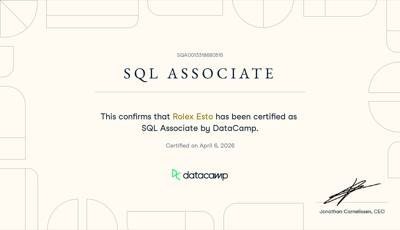
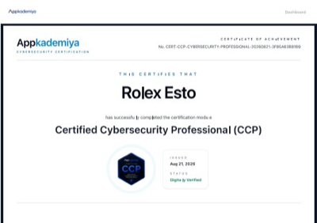
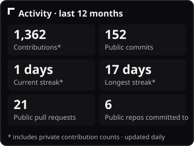
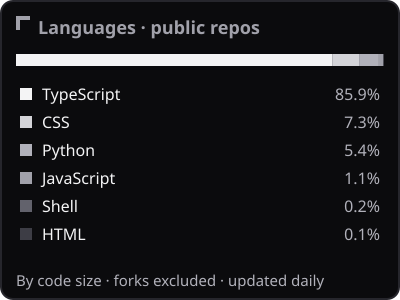
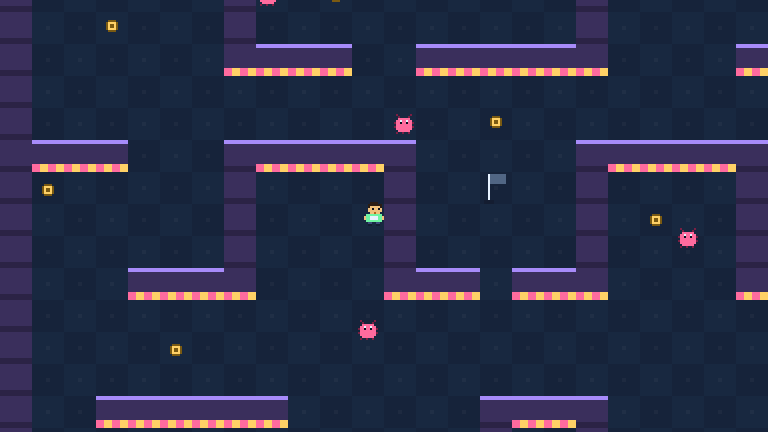

<!-- Profile graphics: assets/profile (regenerate with scripts/generate-profile-assets.py). Stats: output branch, built daily by .github/workflows/snake.yml.
     Rule: images carry identity, not information. Everything a visitor needs to read is Markdown text so it stays legible on phones. -->
<div align="center">

<picture>
  <source media="(prefers-color-scheme: dark)" srcset="assets/profile/hero-dark.svg">
  <source media="(prefers-color-scheme: light)" srcset="assets/profile/hero-light.svg">
  
</picture>

**I build AI-powered apps, data pipelines, and cloud web products.**<br/>
Founder of **BizPilot** · **Microsoft Certified: Fabric Data Engineer Associate** · **4× hackathon top finishes in 2026**

<a href="#featured-projects"></a>
<a href="https://rolex-esto.vercel.app/"></a>
<a href="https://linkedin.com/in/rolex-esto-1b33b2391/"></a>
<a href="mailto:rolexesto0001@gmail.com"></a>
<a href="#achievements--certifications"></a>
<a href="https://rolex-esto.github.io/rolex-esto/arcade/"></a>

</div>

## About Me

I'm a 4th-year **BSIT student at STI College Fairview** (2023 – 2027) who likes shipping real software: **AI-powered apps**, **data pipelines**, and **cloud-backed web products**. I founded **BizPilot**, build client websites and NFC pages at **TAPME**, and spend weekends at hackathons, where my teams reached the **top finishes four times in 2026**. I'm an **Eskwelabs Innovation Fellow** (Cohort 11) and completed **GCI World 2026** at the University of Tokyo.

```yaml
building:
  - BizPilot (founder)
  - TAPME sites & NFC pages
  - Fabric data pipelines
focus: [AI apps, data, cloud]
certified:
  - Microsoft DP-700
  - ISC2 CC
  - +7 more (see below)
recognized:
  - DICT Cybersecurity Pro, Cat. 2
```


## Featured Projects

###  BizPilot
**Founder & Developer** · *Active development* · Operations hub for Filipino online sellers

**Problem:** sellers juggle customer messages across social channels, unverified payment receipts, overselling, and manual order math during sales surges.<br/>
**Built:** one inbox for social messages, one-click ordering inside conversations, stock management, a shared operations calendar, and an AI sales assistant, with each seller’s data kept private.<br/>
**Highlights:** `Unified inbox` `AI sales assistant` `Conversational ordering` `Operations calendar`

[Live site ↗](https://biz-pilot-msme.vercel.app/) · 🔒 Private repository

###  SmartWatts
**Lead Developer, Team KuryenTech** · 🏅 **Top 10 Finalist, Meralco IDOL Hackathon** · Electricity-use tracker

**Problem:** households struggle to make sense of their electricity consumption.<br/>
**Built:** bill scanning, appliance and meter records, usage trends, estimates and practical suggestions. SmartWatts Personal adds goals, challenges, rewards and an AI advisor in English and Tagalog; SmartWatts Rentals lets property managers organize units, invite tenants, record readings and prepare electricity statements.<br/>
**Highlights:** `Bill scanning` `Appliance tracking` `Usage estimates` `AI advisor (EN/TL)`

Hackathon project · no public repository or demo

###  OpsPilot
**Solo Developer** · 🏆 **Top 2 Winner, DevKada × ClankerCloud Build Challenge** · AI DevOps incident investigator

**Problem:** under incident pressure, teams act on a plausible-looking root cause that isn’t the real one, and an AI that sounds certain makes it worse.<br/>
**Built:** an investigator that works from evidence, tracks hypotheses, and says clearly when a cause has not been confirmed yet.<br/>
**Stack:** `AI agent design` `Prompt & skill architecture` `Incident response` `Cloud observability`

[Repository ↗](https://github.com/rolex-esto/opspilot)

###  BahaRoute
**Lead Developer** · 🏅 **Top 36 Team · Top 10 Climate Change Track, BuildOvernights KiroxHackaton** · Flood-aware routing

**Problem:** Metro Manila drivers need flood context alongside directions during heavy rain.<br/>
**Built (in a 12-hour hackathon):** routes away from flood-prone roads across 17 cities and 1,710 barangays, using Project NOAH flood history, live rainfall forecasts, and spoken hazard alerts.<br/>
**Highlights:** `Project NOAH flood data` `Rainfall forecasts` `Voice hazard alerts`

[Repository ↗](https://github.com/rolex-esto/KiroxQuick_Flood_CTRL) · [Live demo ↗](https://baha-route.vercel.app/)

###  Weather Weather Lang
**AI Orchestrator, team project** · 🏆 **3rd Place, KiroVerse Hack Sprint (AWS &amp; RevenueCat)** · Conversational weather companion

**Problem:** the team wanted conversational querying, travel decisions and historical comparison in a hackathon window far too short for that scope.<br/>
**Built:** a chat-style weather companion that gives friendly weather updates, extending my Ulan Ba? dashboard with a conversational assistant and client-side SQL.<br/>
**Stack:** `React 18` `TypeScript` `Vite` `DuckDB-WASM` `Parquet` `Recharts` `Open-Meteo API` `Playwright`

[Team repository ↗](https://github.com/rolex-esto/Kirovers-Hack-Sprint-Shipaton-Edition) · [Live demo ↗](https://kiroverse-hack-sprint-shipaton-edition.vercel.app/)

###  Ulan Ba?
**Creator & Frontend Developer (solo)** · Philippine rain forecast dashboard

**Problem:** commuters and travelers lacked hyper-local, actionable rainfall forecasts during localized downpours.<br/>
**Built:** hourly rain and severity forecasts for 17 regions and 150+ cities, with automatic location detection.<br/>
**Stack:** `React` `TypeScript` `Vite` `Recharts` `Open-Meteo API` `Geolocation`

[Repository ↗](https://github.com/rolex-esto/kiro-phWeather)

<details>
<summary><b>More work</b> · Classic Flagship Store · TAPME</summary>

<br/>

** Classic Flagship Store** — E-commerce capstone. An online store with separate admin, cashier and customer dashboards, secure Google sign-in, and inventory tools, replacing manual store management and disconnected POS/cart operations. `PHP` `MySQL` `PDO` `Google OAuth` `PHPMailer` · [Live site ↗](https://classicflagshipstore.com/) · 🔒 Private repository

** TAPME** — Freelance web development (2025 – Present). NFC tap pages and client websites that help businesses share their details and collect reviews. [Website ↗](https://tapmeph.com/)

</details>


## Tech Stack

- **Languages:** `TypeScript` `JavaScript` `Python` `PHP` `SQL`
- **Frontend:** `React` `Next.js` `Vite` `HTML` `CSS` `Recharts`
- **Backend:** `Node.js` `FastAPI` `OAuth`
- **Data engineering:** `Microsoft Fabric` `Power BI` `Pandas` `NumPy` `DuckDB` `Apache Parquet` `Excel`
- **Databases:** `PostgreSQL` `MySQL`
- **Cloud:** `AWS` `Azure` `Google Cloud` `Vercel`
- **AI tools:** `Claude Code` `Codex` `Cursor` `Kiro` `Antigravity`
- **DevOps & security:** `Git` `GitHub` `GitHub Actions` `Playwright` `IAM`


## Achievements & Certifications

#### Hackathons — 4 top finishes in 2026

-  **Top 2 Winner** — DevKada × ClankerCloud Build Challenge (August 24–29, 2026) · [OpsPilot](https://github.com/rolex-esto/opspilot) · Solo Developer
-  **3rd Place** — KiroVerse Hack Sprint (AWS &amp; RevenueCat, June – August 2026) · [Weather Weather Lang](https://github.com/rolex-esto/Kirovers-Hack-Sprint-Shipaton-Edition) · AI Orchestrator
-  **Top 10 Finalist** — Meralco IDOL Hackathon · Meralco Power Academy (November 12–13, 2026) · **Team KuryenTech** · Lead Developer
-  **Top 36 Team · Top 10 Climate Change Track** — BuildOvernights KiroxHackaton (AWS Office, October 3–4, 2026) · [BahaRoute](https://github.com/rolex-esto/KiroxQuick_Flood_CTRL) · Lead Developer

#### Certifications — 9 certifications · 1 professional recognition

**Featured:** **Microsoft Certified: Fabric Data Engineer Associate (DP-700)** · Earned Nov 2026 · Valid until Nov 10, 2027 · [**Verify on Microsoft Learn ↗**](https://learn.microsoft.com/en-us/users/rolexesto-7021/credentials/certification/fabric-data-engineer-associate?tab=credentials-tab)

- **Microsoft:** Fabric Data Engineer Associate (DP-700), Nov 2026
- **Data:** DataCamp Certified Associate Data Engineer (Jul 2026) · Associate Data Analyst (May 2026) · SQL Associate (Apr 2026) · Data Literacy (Jul 2026)
- **Security:** ISC2 Certified in Cybersecurity (CC), Mar 2026 · Appkademiya Certified Cybersecurity Professional (CCP), Aug 2026 · Red Team Leaders Certified Threat Intelligence &amp; Governance Analyst (CTIGA), Jan 2026
- **AI:** Google AI Professional Certificate, Aug 2026
- **Professional recognition:** DICT-Recognized Cybersecurity Professional, Category 2 (Intermediate), Sep 2026
- **Training completed:** AWS SimuLearn: Cloud Practitioner (Jul 2026) · Microsoft curriculum tracks: DP-900 Azure Data Fundamentals (Jul 2026), DP-700 Fabric Data Engineer (Aug 2026), PL-300 Power BI Data Analyst (Oct 2026) · DICT Region V Data Privacy Protection Competency Framework, 20-Hour Intensive Training (Jun 2026)

<details>
<summary><b>Certificate gallery</b> · 11 certificate images</summary>

<br/>

<table width="100%">
<tr><td align="center" valign="top" width="50%"><a href="assets/certs/dp700.png"></a><br/><b>Microsoft Certified: Fabric Data Engineer Associate (DP-700)</b><br/><sub>Microsoft · Nov 2026 · Valid until Nov 10, 2027</sub></td><td align="center" valign="top" width="50%"><a href="assets/certs/aws-simulearn.png"></a><br/><b>AWS SimuLearn: Cloud Practitioner</b><br/><sub>AWS · Jul 2026 · Training, completion certificate</sub></td></tr>
<tr><td align="center" valign="top" width="50%"><a href="assets/certs/datacamp-data-engineer.png"></a><br/><b>DataCamp Certified Associate Data Engineer</b><br/><sub>DataCamp · Jul 2026</sub></td><td align="center" valign="top" width="50%"><a href="assets/certs/datacamp-data-analyst.png"></a><br/><b>DataCamp Certified Associate Data Analyst</b><br/><sub>DataCamp · May 2026</sub></td></tr>
<tr><td align="center" valign="top" width="50%"><a href="assets/certs/datacamp-sql.png"></a><br/><b>DataCamp Certified SQL Associate</b><br/><sub>DataCamp · Apr 2026</sub></td><td align="center" valign="top" width="50%"><a href="assets/certs/datacamp-data-literacy.png"></a><br/><b>DataCamp Certified in Data Literacy</b><br/><sub>DataCamp · Jul 2026</sub></td></tr>
<tr><td align="center" valign="top" width="50%"><a href="assets/certs/isc2-cc.png"></a><br/><b>Certified in Cybersecurity (CC)</b><br/><sub>ISC2 · Mar 2026 · Cycle: Mar 2026 – Feb 2029</sub></td><td align="center" valign="top" width="50%"><a href="./dict-cyberpro-badge.png"></a><br/><b>DICT-Recognized Cybersecurity Professional, Category 2</b><br/><sub>DICT · Sep 2026 · Professional recognition</sub></td></tr>
<tr><td align="center" valign="top" width="50%"><a href="assets/certs/appkademiya-ccp.png"></a><br/><b>Certified Cybersecurity Professional (CCP)</b><br/><sub>Appkademiya · Aug 2026</sub></td><td align="center" valign="top" width="50%"><a href="assets/certs/ctiga.png"></a><br/><b>Certified Threat Intelligence &amp; Governance Analyst (CTIGA)</b><br/><sub>Red Team Leaders · Jan 2026</sub></td></tr>
<tr><td align="center" valign="top" width="50%"><a href="assets/certs/google-ai.png"></a><br/><b>Google AI Professional Certificate</b><br/><sub>Google · Aug 2026</sub></td><td></td></tr>
</table>

</details>

<details>
<summary><b>Certification journey</b> · January 2026 → November 2026</summary>

<br/>

| Date | Milestone |
|---|---|
| **January 2026** | Red Team Leaders Certified Threat Intelligence &amp; Governance Analyst (CTIGA) |
| **March 2026** | ISC2 Certified in Cybersecurity (CC) |
| **April 2026** | DataCamp Certified SQL Associate |
| **May 2026** | DataCamp Certified Associate Data Analyst |
| **June 2026** | DICT Region V Data Privacy Protection Competency Framework, 20-Hour Intensive Training |
| **July 2026** | DataCamp Certified Associate Data Engineer · DataCamp Certified in Data Literacy · AWS SimuLearn Cloud Practitioner · Microsoft DP-900 curriculum track |
| **August 2026** | Google AI Professional Certificate · Appkademiya Certified Cybersecurity Professional (CCP) · Microsoft DP-700 curriculum track |
| **September 2026** | DICT-Recognized Cybersecurity Professional Category 2 (Intermediate) |
| **October 2026** | Microsoft PL-300 Power BI Data Analyst curriculum track |
| **November 2026** | Microsoft Certified: Fabric Data Engineer Associate (DP-700) |

</details>

<sub>Only the DP-700 has a verification link; every other thumbnail opens the full-size certificate image. DICT Category 2 is a professional recognition, not an exam certificate. AWS SimuLearn, the Microsoft curriculum tracks and DICT Region V are training.</sub>


## Experience & Fellowships

- **Freelance Web Developer** — [TAPME](https://tapmeph.com/) · 2025 – Present
- **Startup Founder & Developer** — BizPilot · Active development
- **Data Innovation Fellow**, Cohort 11 — Eskwelabs Innovation Fellowship (EIF) · August 2026 – November 2026
- **Participant**, Data Science & AI — GCI World 2026 · Matsuo-Iwasawa Laboratory, University of Tokyo · September 2026 – November 2026
- **BSIT student** — STI College Fairview, Quezon City, PH · September 2023 – July 2027

<details>
<summary><b>What I do at TAPME</b></summary>

<br/>

- Build the pages that open when customers tap TAPME NFC products, including digital calling cards, Google Review and social media tap pages, menus, and brochures.
- Develop client websites for TAPME packages, from showcase sites to sites with admin tools owners can manage.
- Make sure every tap or QR scan opens cleanly on any phone.

</details>

<details>
<summary><b>Fellowships & professional training</b></summary>

<br/>

**Eskwelabs Innovation Fellowship (EIF)** — Selected for Cohort 11’s Data Innovation track, collaborating on projects across analytics, data modeling, strategy and management, and learning experience design (August 2026 – November 2026).

**GCI World 2026** — Completed a global data science and AI program under the Matsuo-Iwasawa Laboratory, University of Tokyo, applying data-driven methods and intelligent systems to real-world software and data engineering projects (September 2026 – November 2026).

**Completed professional tracks:** AWS SimuLearn Cloud Practitioner (July 2026) · Microsoft DP-900, DP-700 and PL-300 curriculum tracks (July – October 2026) · DICT Region V Data Privacy Protection Competency Framework, 20-Hour Intensive Training (June 2026).

</details>

<details>
<summary><b>Leadership & affiliations</b></summary>

<br/>

- **Founding President**, Microsoft Student Community, STI Fairview
- **AWS Learning Club Lead**, AWS Student User Group Philippines
- **Delegate / Representative**, Data Engineering Pilipinas x Echelon 2026 by Brainsparks (August 25–26, 2026)
- **Venue Partnerships Associate**, Seekers Guild (August 2026 – November 2026)

**Affiliations:** ISC2 Philippines Chapter · Data Engineering Pilipinas × DataCamp Donates (Scholar) · STI Fairview Bytes · STI Alumni Scholarship · DTI Metro Manila × Google Career Certificate Scholar · Cisco NetConnect PUP – Manila (Cybersecurity Operations)

</details>


## GitHub Stats

<p align="center">
  <picture>
    <source media="(prefers-color-scheme: dark)" srcset="https://raw.githubusercontent.com/rolex-esto/rolex-esto/output/stats-activity-dark.svg">
    <source media="(prefers-color-scheme: light)" srcset="https://raw.githubusercontent.com/rolex-esto/rolex-esto/output/stats-activity-light.svg">
    
  </picture>
  <picture>
    <source media="(prefers-color-scheme: dark)" srcset="https://raw.githubusercontent.com/rolex-esto/rolex-esto/output/stats-languages-dark.svg">
    <source media="(prefers-color-scheme: light)" srcset="https://raw.githubusercontent.com/rolex-esto/rolex-esto/output/stats-languages-light.svg">
    
  </picture>
</p>

<p align="center">
  <picture>
    <source media="(prefers-color-scheme: dark)" srcset="https://raw.githubusercontent.com/rolex-esto/rolex-esto/output/github-snake-dark.svg">
    <source media="(prefers-color-scheme: light)" srcset="https://raw.githubusercontent.com/rolex-esto/rolex-esto/output/github-snake.svg">
    
  </picture>
</p>

<sub>Generated daily from GitHub’s API by this repository’s own workflow (no third-party stats service). Contributions and streaks include private contribution counts that the profile is set to show; commits, pull requests and languages are public-only.</sub>


## Take a Break — Play My Arcade Game

<a href="https://rolex-esto.github.io/rolex-esto/arcade/"></a>

**ROLEX.EXE: BUG HUNTER** is a small browser game I built from scratch in vanilla JavaScript. Clear five worlds, each themed on one of my projects, by collecting tokens and dodging bugs. Clearing a world unlocks that project’s details, and there is a read-only portfolio terminal (`help`, `projects`, `contact`).

<a href="https://rolex-esto.github.io/rolex-esto/arcade/"></a>
<a href="arcade/"></a>

**Controls:** WASD or arrow keys to move · P to pause · on-screen D-pad on phones · reduced-motion and assist modes


<div align="center">

## Let's Connect

I'm most interested in opportunities where I can build, experiment, ship, and learn from real-world problems.

<a href="https://rolex-esto.vercel.app/"></a>
<a href="https://linkedin.com/in/rolex-esto-1b33b2391/"></a>
<a href="mailto:rolexesto0001@gmail.com"></a>

</div>
