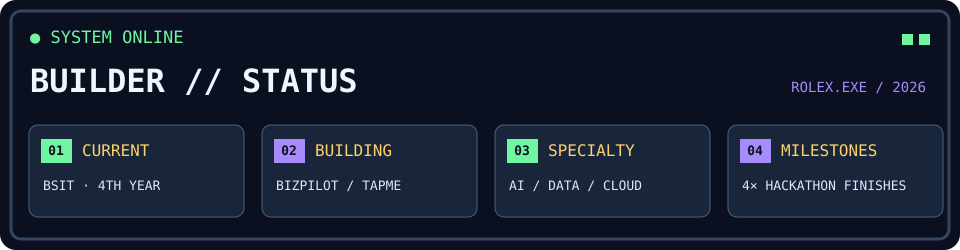
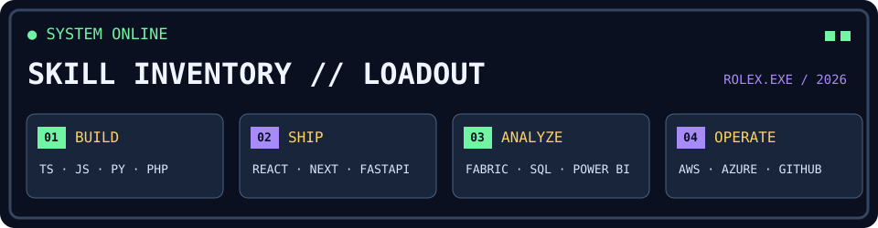
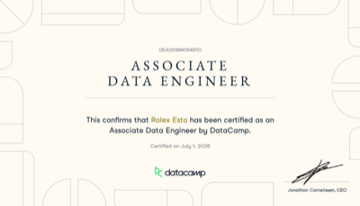
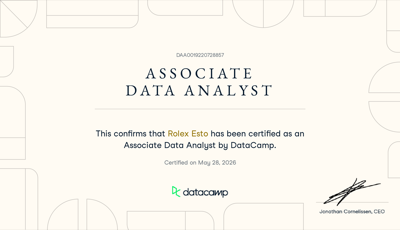

<!-- Profile graphics: assets/profile (regenerate with scripts/generate-profile-assets.py). Stats: output branch, built daily by .github/workflows/snake.yml.
     Rule: images carry identity, not information. Everything a visitor needs to read is Markdown text so it stays legible on phones. -->

<picture>
  <source media="(prefers-color-scheme: dark)" srcset="assets/profile/hero-dark.svg">
  <source media="(prefers-color-scheme: light)" srcset="assets/profile/hero-light.svg">
  
</picture>

**I build AI-powered apps, data pipelines, and cloud web products.** 
Founder of **BizPilot** · **Microsoft Certified: Fabric Data Engineer Associate** · **4× hackathon top finishes in 2026**

## About Me

> **Hello, world!** I'm a fourth-year **BSIT student at STI College Fairview (2023–2027)** who builds practical, production-minded software. From AI-powered applications and data pipelines to cloud-backed products, I care about the problem a project solves—not just the stack behind it.

<table>
<tr><td width="50%" valign="top">

** Currently building**

- **BizPilot** — founder and developer
- **TAPME** — client websites and NFC pages
- **Microsoft Fabric** — data pipelines

</td><td width="50%" valign="top">

**🏅 Beyond the code**

- **Four** hackathon top finishes in 2026
- **Eskwelabs** Innovation Fellow, Cohort 11
- **GCI World 2026**, University of Tokyo
- **DICT** Cybersecurity Professional, Category 2

</td></tr>
</table>

**Core focus** &nbsp;   

**Credentials at a glance:** Microsoft DP-700 · ISC2 CC · seven other certifications · DICT professional recognition. [Explore credentials ↓](#achievements--certifications)

## Featured Projects

**Six featured builds.** Each solves a practical problem, from small-business operations to disaster-aware travel. Explore the projects and their underlying engineering decisions below.

###  BizPilot

**Founder & Developer** · Active development · MSME operations

| Challenge | Solution |
|:--|:--|
| Online sellers juggle fragmented messages, unverified receipts, overselling, and manual calculations. | A unified inbox, conversational ordering, inventory management, operations calendar, and seller-private AI sales assistant. |

`Unified inbox` `AI sales assistant` `Conversational ordering` `Operations calendar`  

[**Visit live site ↗**](https://biz-pilot-msme.vercel.app/) · 🔒 Private repository

###  SmartWatts

**Lead Developer · Team KuryenTech** · 🏅 Top 10 Finalist · Meralco IDOL Hackathon

| Challenge | Solution |
|:--|:--|
| Households lack understandable information about electricity consumption. | Bill scanning, appliance and meter records, consumption estimates, and insights. Personal adds goals, rewards and an EN/TL AI advisor; Rentals adds units, tenants, readings and electricity statements. |

`Bill scanning` `Appliance tracking` `Usage estimates` `AI advisor EN/TL`  

*Hackathon project · No public repository or demo*

###  OpsPilot

**Solo Developer** · 🏆 Top 2 Winner · DevKada × ClankerCloud

| Challenge | Solution |
|:--|:--|
| Teams under incident pressure can accept plausible but unsupported AI root-cause explanations. | An evidence-first incident investigator that tracks hypotheses and distinguishes confirmed causes from uncertainty. |

`AI agent design` `Incident response` `Evidence tracking` `Cloud observability`  

[**Explore repository ↗**](https://github.com/rolex-esto/opspilot)

###  BahaRoute

**Lead Developer** · 🏅 Top 36 Team · Top 10 Climate Change Track

| Challenge | Solution |
|:--|:--|
| Metro Manila drivers need flood conditions integrated into routing decisions during heavy rain. | A 12-hour hackathon prototype using Project NOAH flood history, live rainfall, and voice hazard alerts for 17 cities and 1,710 barangays. |

`Project NOAH` `Rainfall forecasts` `Voice alerts`  

[**Repository ↗**](https://github.com/rolex-esto/KiroxQuick_Flood_CTRL) · [**Live demo ↗**](https://baha-route.vercel.app/)

###  Weather Weather Lang

**AI Orchestrator · Team project** · 🏆 3rd Place · KiroVerse Hack Sprint

| Challenge | Solution |
|:--|:--|
| Conversational weather queries, travel decisions, and historical comparisons had to be built during a short hackathon. | A chat-style weather companion extending Ulan Ba? with a conversational assistant and client-side SQL querying. |

`React 18` `TypeScript` `DuckDB-WASM` `Parquet` `Open-Meteo` `Playwright`  

[**Team repository ↗**](https://github.com/rolex-esto/Kirovers-Hack-Sprint-Shipaton-Edition) · [**Live demo ↗**](https://kiroverse-hack-sprint-shipaton-edition.vercel.app/)

###  Ulan Ba?

**Creator & Frontend Developer · Solo** · Philippine rainfall dashboard

| Challenge | Solution |
|:--|:--|
| Commuters and travelers need more actionable local rainfall information. | Hourly rainfall and severity forecasts across 17 regions and 150+ cities, with automatic location detection. |

`React` `TypeScript` `Vite` `Recharts` `Open-Meteo` `Geolocation`  

[**Repository ↗**](https://github.com/rolex-esto/kiro-phWeather)

<b>＋ More work</b> · Classic Flagship Store & TAPME

**Classic Flagship Store** — E-commerce capstone with admin, cashier and customer dashboards, Google sign-in, and integrated inventory/POS operations. `PHP` `MySQL` `PDO` `Google OAuth` · [Site ↗](https://classicflagshipstore.com/) · Private repository.

**TAPME** — Freelance client websites and NFC pages, from digital calling cards to menus and Google Review tap pages. [Website ↗](https://tapmeph.com/)

## Tech Stack

<b>⌘ Explore my developer toolkit</b>

| Discipline | Technologies |
|:--|:--|
| **Languages** | `TypeScript` `JavaScript` `Python` `PHP` `SQL` |
| **Frontend** | `React` `Next.js` `Vite` `HTML` `CSS` `Recharts` |
| **Backend** | `Node.js` `FastAPI` `OAuth` |
| **Data engineering** | `Microsoft Fabric` `Power BI` `Pandas` `NumPy` `DuckDB` `Apache Parquet` `Excel` |
| **Databases** | `PostgreSQL` `MySQL` |
| **Cloud** | `AWS` `Azure` `Google Cloud` `Vercel` |
| **AI-assisted development** | `Claude Code` `Codex` `Cursor` `Kiro` `Antigravity` |
| **DevOps & Security** | `Git` `GitHub` `GitHub Actions` `Playwright` `IAM` |

## Achievements & Certifications

### 🏆 Achievement Unlocked · Four 2026 Hackathon Finishes

| Award | Event & project | Contribution |
|:--|:--|:--|
| 🥇 **Top 2 Winner** | DevKada × ClankerCloud · [OpsPilot](https://github.com/rolex-esto/opspilot) · Aug 24–29 | Solo Developer |
| 🥉 **3rd Place** | KiroVerse Hack Sprint · [Weather Weather Lang](https://github.com/rolex-esto/Kirovers-Hack-Sprint-Shipaton-Edition) · Jun–Aug | AI Orchestrator |
| 🏅 **Top 10 Finalist** | Meralco IDOL Hackathon · Team KuryenTech · Nov 12–13 | Lead Developer |
| 🎖️ **Top 36 / Climate Track Top 10** | BuildOvernights KiroxHackaton · [BahaRoute](https://github.com/rolex-esto/KiroxQuick_Flood_CTRL) · Oct 3–4 | Lead Developer |

#### Certifications — 9 certifications · 1 professional recognition

**Featured:** **Microsoft Certified: Fabric Data Engineer Associate (DP-700)** · Earned Nov 2026 · Valid until Nov 10, 2027 · [**Verify on Microsoft Learn ↗**](https://learn.microsoft.com/en-us/users/rolexesto-7021/credentials/certification/fabric-data-engineer-associate?tab=credentials-tab)

- **Microsoft:** Fabric Data Engineer Associate (DP-700), Nov 2026
- **Data:** DataCamp Certified Associate Data Engineer (Jul 2026) · Associate Data Analyst (May 2026) · SQL Associate (Apr 2026) · Data Literacy (Jul 2026)
- **Security:** ISC2 Certified in Cybersecurity (CC), Mar 2026 · Appkademiya Certified Cybersecurity Professional (CCP), Aug 2026 · Red Team Leaders Certified Threat Intelligence &amp; Governance Analyst (CTIGA), Jan 2026
- **AI:** Google AI Professional Certificate, Aug 2026
- **Professional recognition:** DICT-Recognized Cybersecurity Professional, Category 2 (Intermediate), Sep 2026
- **Training completed:** AWS SimuLearn: Cloud Practitioner (Jul 2026) · Microsoft curriculum tracks: DP-900 Azure Data Fundamentals (Jul 2026), DP-700 Fabric Data Engineer (Aug 2026), PL-300 Power BI Data Analyst (Oct 2026) · DICT Region V Data Privacy Protection Competency Framework, 20-Hour Intensive Training (Jun 2026)

<b>Certificate gallery</b> · 11 certificate images

 

<table width="100%">
<tr><td align="center" valign="top" width="50%"> <b>Microsoft Certified: Fabric Data Engineer Associate (DP-700)</b> Microsoft · Nov 2026 · Valid until Nov 10, 2027</td><td align="center" valign="top" width="50%"> <b>AWS SimuLearn: Cloud Practitioner</b> AWS · Jul 2026 · Training, completion certificate</td></tr>
<tr><td align="center" valign="top" width="50%"> <b>DataCamp Certified Associate Data Engineer</b> DataCamp · Jul 2026</td><td align="center" valign="top" width="50%"> <b>DataCamp Certified Associate Data Analyst</b> DataCamp · May 2026</td></tr>
<tr><td align="center" valign="top" width="50%"> <b>DataCamp Certified SQL Associate</b> DataCamp · Apr 2026</td><td align="center" valign="top" width="50%"> <b>DataCamp Certified in Data Literacy</b> DataCamp · Jul 2026</td></tr>
<tr><td align="center" valign="top" width="50%"> <b>Certified in Cybersecurity (CC)</b> ISC2 · Mar 2026 · Cycle: Mar 2026 – Feb 2029</td><td align="center" valign="top" width="50%"> <b>DICT-Recognized Cybersecurity Professional, Category 2</b> DICT · Sep 2026 · Professional recognition</td></tr>
<tr><td align="center" valign="top" width="50%"> <b>Certified Cybersecurity Professional (CCP)</b> Appkademiya · Aug 2026</td><td align="center" valign="top" width="50%"> <b>Certified Threat Intelligence &amp; Governance Analyst (CTIGA)</b> Red Team Leaders · Jan 2026</td></tr>
<tr><td align="center" valign="top" width="50%"> <b>Google AI Professional Certificate</b> Google · Aug 2026</td><td></td></tr>
</table>

<b>Certification journey</b> · January 2026 → November 2026

 

| Date | Milestone |
|---|---|
| **January 2026** | Red Team Leaders Certified Threat Intelligence &amp; Governance Analyst (CTIGA) |
| **March 2026** | ISC2 Certified in Cybersecurity (CC) |
| **April 2026** | DataCamp Certified SQL Associate |
| **May 2026** | DataCamp Certified Associate Data Analyst |
| **June 2026** | DICT Region V Data Privacy Protection Competency Framework, 20-Hour Intensive Training |
| **July 2026** | DataCamp Certified Associate Data Engineer · DataCamp Certified in Data Literacy · AWS SimuLearn Cloud Practitioner · Microsoft DP-900 curriculum track |
| **August 2026** | Google AI Professional Certificate · Appkademiya Certified Cybersecurity Professional (CCP) · Microsoft DP-700 curriculum track |
| **September 2026** | DICT-Recognized Cybersecurity Professional Category 2 (Intermediate) |
| **October 2026** | Microsoft PL-300 Power BI Data Analyst curriculum track |
| **November 2026** | Microsoft Certified: Fabric Data Engineer Associate (DP-700) |

Only the DP-700 has a verification link; every other thumbnail opens the full-size certificate image. DICT Category 2 is a professional recognition, not an exam certificate. AWS SimuLearn, the Microsoft curriculum tracks and DICT Region V are training.

## Experience & Fellowships

### Career & Learning Timeline

| When | Role / Program | What I do |
|:--|:--|:--|
| **2025 – Present** | **Freelance Web Developer** · [TAPME](https://tapmeph.com/) | Client websites, NFC tap pages, and mobile-friendly customer journeys |
| **Active development** | **Founder & Developer** · BizPilot | Build a unified operations hub for Filipino online sellers |
| **Aug – Nov 2026** | **Data Innovation Fellow** · Eskwelabs, Cohort 11 | Applied analytics, data modeling, and innovation projects |
| **Sep – Nov 2026** | **Data Science & AI Participant** · GCI World 2026, University of Tokyo | Applied data-driven methods to real-world software challenges |
| **Sep 2023 – Jul 2027** | **BSIT** · STI College Fairview | Bachelor of Science in Information Technology |

<b>What I do at TAPME</b>

 

- Build the pages that open when customers tap TAPME NFC products, including digital calling cards, Google Review and social media tap pages, menus, and brochures.
- Develop client websites for TAPME packages, from showcase sites to sites with admin tools owners can manage.
- Make sure every tap or QR scan opens cleanly on any phone.

<b>Fellowships & professional training</b>

 

**Eskwelabs Innovation Fellowship (EIF)** — Selected for Cohort 11’s Data Innovation track, collaborating on projects across analytics, data modeling, strategy and management, and learning experience design (August 2026 – November 2026).

**GCI World 2026** — Completed a global data science and AI program under the Matsuo-Iwasawa Laboratory, University of Tokyo, applying data-driven methods and intelligent systems to real-world software and data engineering projects (September 2026 – November 2026).

**Completed professional tracks:** AWS SimuLearn Cloud Practitioner (July 2026) · Microsoft DP-900, DP-700 and PL-300 curriculum tracks (July – October 2026) · DICT Region V Data Privacy Protection Competency Framework, 20-Hour Intensive Training (June 2026).

<b>Leadership & affiliations</b>

 

- **Founding President**, Microsoft Student Community, STI Fairview
- **AWS Learning Club Lead**, AWS Student User Group Philippines
- **Delegate / Representative**, Data Engineering Pilipinas x Echelon 2026 by Brainsparks (August 25–26, 2026)
- **Venue Partnerships Associate**, Seekers Guild (August 2026 – November 2026)

**Affiliations:** ISC2 Philippines Chapter · Data Engineering Pilipinas × DataCamp Donates (Scholar) · STI Fairview Bytes · STI Alumni Scholarship · DTI Metro Manila × Google Career Certificate Scholar · Cisco NetConnect PUP – Manila (Cybersecurity Operations)

## GitHub Stats

  <picture>
    <source media="(prefers-color-scheme: dark)" srcset="https://raw.githubusercontent.com/rolex-esto/rolex-esto/output/stats-activity-dark.svg">
    <source media="(prefers-color-scheme: light)" srcset="https://raw.githubusercontent.com/rolex-esto/rolex-esto/output/stats-activity-light.svg">
    
  </picture>
  <picture>
    <source media="(prefers-color-scheme: dark)" srcset="https://raw.githubusercontent.com/rolex-esto/rolex-esto/output/stats-languages-dark.svg">
    <source media="(prefers-color-scheme: light)" srcset="https://raw.githubusercontent.com/rolex-esto/rolex-esto/output/stats-languages-light.svg">
    
  </picture>

  <picture>
    <source media="(prefers-color-scheme: dark)" srcset="https://raw.githubusercontent.com/rolex-esto/rolex-esto/output/github-snake-dark.svg">
    <source media="(prefers-color-scheme: light)" srcset="https://raw.githubusercontent.com/rolex-esto/rolex-esto/output/github-snake.svg">
    
  </picture>

Generated daily from GitHub’s API by this repository’s own workflow (no third-party stats service). Contributions and streaks include private contribution counts that the profile is set to show; commits, pull requests and languages are public-only.

## Take a Break — Play My Arcade Game

**ROLEX.EXE: BUG HUNTER** is a small browser game I built from scratch in vanilla JavaScript. Clear five worlds, each themed on one of my projects, by collecting tokens and dodging bugs. Clearing a world unlocks that project’s details, and there is a read-only portfolio terminal (`help`, `projects`, `contact`).

**Controls:** WASD or arrow keys to move · P to pause · on-screen D-pad on phones · reduced-motion and assist modes

## Let's Connect

I'm most interested in opportunities where I can build, experiment, ship, and learn from real-world problems.

