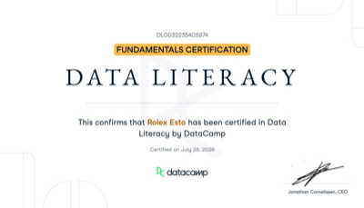
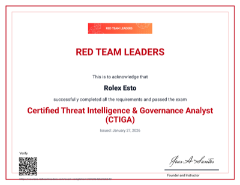

<!-- ROLEX.EXE — Developer Quest · original pixel art: assets/arcade (regenerate with scripts/generate-pixel-assets.py) -->

<a href="arcade/">
  <picture>
    <source media="(prefers-color-scheme: dark)" srcset="assets/arcade/hero-dark.svg">
    <source media="(prefers-color-scheme: light)" srcset="assets/arcade/hero-light.svg">
    
  </picture>
</a>

**[Player Profile](#player-profile)** · **[World Map](#world-map)** · **[Trophy Room](#trophy-room)** · **[Skill Tree](#skill-tree)** · **[Quest Log](#quest-log)** · **[Arcade Stats](#arcade-stats)** · **[Continue?](#continue)**

> [!NOTE]
> **How this profile plays:** GitHub READMEs can't run JavaScript, so everything on this page is click-to-expand. The real game — **BUG HUNTER**, a five-world, top-down pixel quest with a portfolio terminal — lives in [`arcade/`](arcade/). XP, levels and badges are game mechanics only; credentials in the Trophy Room are real.

## Player Profile

| ATTRIBUTE | PLAYER 01 |
|:--|:--|
| **PLAYER** | Rolex J. Esto |
| **CLASS** | Software Developer / AI Builder |
| **SPECIALIZATIONS** | Software · AI · Data · Cloud · Cybersecurity |
| **HOME BASE** | 4th-year BSIT student, **STI College Fairview** (September 2023 – July 2027) |
| **GUILDS** | **Eskwelabs Innovation Fellowship (EIF)**, Cohort 11 · **GCI World 2026** participant at the University of Tokyo |
| **RANK** | **DICT-Recognized Cybersecurity Professional**, Category 2 (Intermediate) · **Microsoft Certified: Fabric Data Engineer Associate** |
| **HIGH SCORES** | 4× hackathon top finishes — **OpsPilot**, **Weather Weather Lang**, **BahaRoute**, **SmartWatts** |
| **CURRENT QUEST** | BizPilot · TAPME client websites and NFC pages · Microsoft Fabric data pipelines |

**I’m a 4th-year BSIT student building practical, production-ready solutions across web development, AI, data, and cloud technologies.**

## World Map

<a href="arcade/">
  <picture>
    <source media="(prefers-color-scheme: dark)" srcset="assets/arcade/quest-map-dark.svg">
    <source media="(prefers-color-scheme: light)" srcset="assets/arcade/quest-map-light.svg">
    
  </picture>
</a>

Each world below is a real project. Open a portal to read the project file.

<b>▸ WORLD 1 · MERCHANT KINGDOM</b> — <b>BizPilot</b>, MSME operations platform

 

**ROLE** Founder & Developer &nbsp;·&nbsp; **STATUS** Active development

**MISSION** One place for Filipino online sellers to manage customer messages, orders, stock, and daily operations, with an AI sales assistant and a shared operations calendar.

**PROJECT FILE** Gives Filipino online sellers one inbox for social messages, one-click ordering in conversations, stock management, and a shared operations calendar. It includes an AI sales assistant and keeps each seller’s data private.

**LOOT** `Unified inbox` `AI sales assistant` `Conversational orders` `Operations calendar`

**PORTALS** [Live site →](https://biz-pilot-msme.vercel.app/) · 🔒 Private repository

<b>▸ WORLD 2 · ENERGY REALM</b> — <b>SmartWatts</b>, electricity use tracker 🏆 Top 10 Finalist

 

**ROLE** Lead Developer, Team KuryenTech &nbsp;·&nbsp; **ACHIEVEMENT** Top 10 Finalist, Meralco IDOL Hackathon

**MISSION** Helps households understand electricity use with bill scanning, appliance tracking, usage trends, estimates, and practical suggestions. SmartWatts Personal includes goals, challenges, rewards, and an AI advisor in English and Tagalog.

**PROJECT FILE** An informational and tracking tool that helps households understand electricity use through bills, appliance records, meter readings, trends, estimates, and practical suggestions. SmartWatts Rentals helps property managers organize units, invite tenants, record readings, and prepare electricity statements, giving managers and tenants a shared view of unit usage.

**LOOT** `Bill scanning` `Appliance tracking` `Usage estimates` `English/Tagalog AI advisor`

<b>▸ WORLD 3 · INCIDENT DUNGEON</b> — <b>OpsPilot</b>, AI DevOps incident investigator 🏆 Top 2 Winner

 

**ROLE** Solo Developer &nbsp;·&nbsp; **ACHIEVEMENT** Top 2 Winner, DevKada × ClankerCloud Build Challenge

**MISSION** Helps tech teams find the cause of system outages and make decisions from evidence during incidents.

**PROJECT FILE** Helps tech teams investigate system outages using evidence and makes clear when the cause has not yet been confirmed.

**LOOT** `Incident evidence` `Hypothesis tracking` `Post-remediation signals`

**PORTALS** [Repository →](https://github.com/rolex-esto/opspilot)

<b>▸ WORLD 4 · FLOODLANDS</b> — <b>BahaRoute</b>, flood-aware routing 🏆 Top 10 Climate Change Track

 

**ROLE** Lead Developer &nbsp;·&nbsp; **ACHIEVEMENT** Top 36 Team · Top 10 Climate Change Track, BuildOvernights KiroxHackaton

**MISSION** Helps drivers avoid flood-prone roads with flood history, rainfall forecasts, and spoken hazard alerts.

**PROJECT FILE** Helps Metro Manila drivers choose routes away from flooded roads across 17 cities and 1,710 barangays, using Project NOAH flood history, live rainfall forecasts, and spoken hazard alerts.

**LOOT** `Project NOAH flood data` `Rainfall forecasts` `Voice hazard alerts`

**PORTALS** [Repository →](https://github.com/rolex-esto/KiroxQuick_Flood_CTRL) · [Live demo →](https://baha-route.vercel.app/)

<b>▸ WORLD 5 · WEATHER WORLD</b> — <b>Weather Weather Lang</b>, conversational weather companion 🏆 3rd Place

 

**ROLE** AI Orchestrator &nbsp;·&nbsp; **ACHIEVEMENT** 3rd Place, KiroVerse Hack Sprint (AWS &amp; RevenueCat)

**MISSION** Gives people friendly weather updates in a chat-style experience.

**PROJECT FILE** A chat-style weather companion that gives people weather updates in a friendly, conversational way.

**STACK** `React 18` `TypeScript` `Vite` `DuckDB-WASM` `Parquet` `Recharts` `Open-Meteo API` `Playwright`

**PORTALS** [Repository →](https://github.com/rolex-esto/Kirovers-Hack-Sprint-Shipaton-Edition) · [Live demo →](https://kiroverse-hack-sprint-shipaton-edition.vercel.app/)

<b>☂ BONUS · RAIN OBSERVATORY</b> — <b>Ulan Ba?</b>, Philippine rain forecast dashboard

 

**ROLE** Creator & Frontend Developer (solo)

**MISSION** Helps people plan trips and outdoor activities with hourly rain and severity forecasts for 17 regions and 150+ cities.

**PROJECT FILE** Helps Filipinos plan travel and outdoor activities around expected rainfall, with hourly rain and severity forecasts for 17 regions and 150+ cities and automatic location detection.

**STACK** `React` `TypeScript` `Vite` `Recharts` `Open-Meteo API` `GPS geolocation`

**PORTALS** [Repository →](https://github.com/rolex-esto/kiro-phWeather)

<b>◇ SIDE QUEST · COMMERCE CITY</b> — <b>Classic Flagship Store</b>, e-commerce capstone

 

**MISSION** An online store with separate admin, cashier, and customer dashboards to make inventory and daily store operations easier.

**PROJECT FILE** An online store for Classic Flagship Store with separate admin, cashier, and customer dashboards, secure Google sign-in, and inventory tools.

**STACK** `PHP` `MySQL` `PDO` `Google OAuth` `PHPMailer`

**PORTALS** [Live site →](https://classicflagshipstore.com/) · 🔒 Private repository

<b>◇ SIDE QUEST · GUILD HALL</b> — <b>TAPME</b>, freelance web development (2025 – Present)

 

**MISSION** Builds NFC pages and client websites that help businesses share their details and collect reviews.

**PORTALS** [Website →](https://tapmeph.com/)

## Trophy Room

Real-world results and credentials — not game scores. Open a chest to inspect the loot.

<b>★ CHEST 1 · HACKATHON TROPHIES</b> — 4× top finishes

 

| | Result | Event | Project / Role |
|:-:|:--|:--|:--|
| 🥈 | **Top 2 Winner** | DevKada × ClankerCloud Build Challenge (August 24–29, 2026) | [OpsPilot](https://github.com/rolex-esto/opspilot) · Solo Developer |
| 🥉 | **3rd Place** | KiroVerse Hack Sprint (AWS &amp; RevenueCat, June – August 2026) | [Weather Weather Lang](https://github.com/rolex-esto/Kirovers-Hack-Sprint-Shipaton-Edition) · AI Orchestrator |
| ⚡ | **Top 10 Finalist** | Meralco IDOL Hackathon · Meralco Power Academy (November 12–13, 2026) | **Team KuryenTech** · Lead Developer |
| 🌊 | **Top 36 Team · Top 10 Climate Change Track** | BuildOvernights KiroxHackaton (AWS Office, October 3–4, 2026) | [BahaRoute](https://github.com/rolex-esto/KiroxQuick_Flood_CTRL) · Lead Developer |

<b>★ CHEST 2 · CERTIFICATIONS</b> — 10 certifications · 2 training tracks

 

<table width="100%">
<tr>
<td width="46%" align="center" valign="middle">

</td>
<td valign="middle">

**LEGENDARY DROP**

### Microsoft Certified: Fabric Data Engineer Associate

**DP-700** · Earned Nov 2026 · Valid until Nov 10, 2027

[**Verify on Microsoft Learn ↗**](https://learn.microsoft.com/en-us/users/rolexesto-7021/credentials/certification/fabric-data-engineer-associate?tab=credentials-tab) · [Full certificate](assets/certs/dp700.png)

</td>
</tr>
</table>

<b>▸ Microsoft &amp; Cloud</b> · 1 certification · 1 training

 

<table width="100%">
<tr><td align="center" valign="top" width="400"> <b>Microsoft Certified: Fabric Data Engineer Associate (DP-700)</b> Microsoft · Nov 2026 Valid until Nov 10, 2027</td><td align="center" valign="top" width="400"> <b>AWS SimuLearn: Cloud Practitioner</b> AWS · Jul 2026 <b>Training</b> · completion certificate</td></tr>
</table>

<b>▸ Data</b> · 4 certifications

 

<table width="100%">
<tr><td align="center" valign="top" width="400"> <b>DataCamp Certified Associate Data Engineer</b> DataCamp · Jul 2026</td><td align="center" valign="top" width="400"> <b>DataCamp Certified Associate Data Analyst</b> DataCamp · May 2026</td></tr>
<tr><td align="center" valign="top" width="400"> <b>DataCamp Certified SQL Associate</b> DataCamp · Apr 2026</td><td align="center" valign="top" width="400"> <b>DataCamp Certified in Data Literacy</b> DataCamp · Jul 2026</td></tr>
</table>

<b>▸ Security</b> · 4 certifications

 

<table width="100%">
<tr><td align="center" valign="top" width="400"> <b>Certified in Cybersecurity (CC)</b> ISC2 · Mar 2026 Cycle: Mar 2026 – Feb 2029</td><td align="center" valign="top" width="400"> <b>DICT-Recognized Cybersecurity Professional, Category 2</b> DICT · Sep 2026 Professional recognition</td></tr>
<tr><td align="center" valign="top" width="400"> <b>Certified Cybersecurity Professional (CCP)</b> Appkademiya · Aug 2026</td><td align="center" valign="top" width="400"> <b>Certified Threat Intelligence &amp; Governance Analyst (CTIGA)</b> Red Team Leaders · Jan 2026</td></tr>
</table>

<b>▸ AI</b> · 1 certification

 

<table width="100%">
<tr><td align="center" valign="top" width="400"> <b>Google AI Professional Certificate</b> Google · Aug 2026</td></tr>
</table>

<b>▸ Certification journey</b> · January 2026 → November 2026

 

| Date | Milestone |
|---|---|
| **January 2026** | Red Team Leaders Certified Threat Intelligence &amp; Governance Analyst (CTIGA) |
| **March 2026** | ISC2 Certified in Cybersecurity (CC) |
| **April 2026** | DataCamp Certified SQL Associate |
| **May 2026** | DataCamp Certified Associate Data Analyst |
| **June 2026** | DICT Region V Data Privacy Protection Competency Framework, 20-Hour Intensive Training |
| **July 2026** | DataCamp Certified Associate Data Engineer · DataCamp Certified in Data Literacy · AWS SimuLearn Cloud Practitioner |
| **August 2026** | Google AI Professional Certificate · Appkademiya Certified Cybersecurity Professional (CCP) |
| **September 2026** | DICT-Recognized Cybersecurity Professional Category 2 (Intermediate) |
| **November 2026** | Microsoft Certified: Fabric Data Engineer Associate (DP-700) |

Only the DP-700 has a verification link; every other thumbnail opens the full-size certificate image. DICT Category 2 is a professional recognition, not an exam certificate. AWS SimuLearn and DICT Region V are training.

<b>★ CHEST 3 · FELLOWSHIPS &amp; TRAINING</b> — Eskwelabs · University of Tokyo GCI

 

**Eskwelabs Innovation Fellowship (EIF)** — Selected for Cohort 11’s Data Innovation track, collaborating on projects across analytics, data modeling, strategy and management, and learning experience design (August 2026 – November 2026).

**GCI World 2026** — Completed a global data science and AI program under the Matsuo-Iwasawa Laboratory, University of Tokyo, applying data-driven methods and intelligent systems to real-world software and data engineering projects (September 2026 – November 2026).

**Completed professional tracks:** AWS SimuLearn Cloud Practitioner (July 2026) · DICT Region V Data Privacy Protection Competency Framework, 20-Hour Intensive Training (June 2026).

<b>★ CHEST 4 · GUILD LEADERSHIP</b> — roles &amp; affiliations

 

- **Founding President**, Microsoft Student Community, STI Fairview
- **AWS Learning Club Lead**, AWS Student User Group Philippines
- **Delegate / Representative**, Data Engineering Pilipinas x Echelon 2026 by Brainsparks (August 25–26, 2026)
- **Venue Partnerships Associate**, Seekers Guild (August 2026 – November 2026)

**Affiliations:** ISC2 Philippines Chapter · Data Engineering Pilipinas × DataCamp Donates (Scholar) · STI Fairview Bytes · STI Alumni Scholarship · DTI Metro Manila × Google Career Certificate Scholar · Cisco NetConnect PUP – Manila (Cybersecurity Operations)

## Skill Tree

Inventory of tools used in shipped projects, coursework, and certifications. No fake proficiency bars.

| Branch | Unlocked |
|:--|:--|
| **Programming** | `JavaScript` `TypeScript` `Python` `PHP` `SQL` |
| **Frontend** | `React` `Next.js` `Vite` `HTML` `CSS` `Recharts` |
| **Backend** | `Node.js` `FastAPI` `OAuth` |
| **Database & Data Engineering** | `MySQL` `PostgreSQL` `Microsoft Fabric` `Power BI` `DuckDB` `Pandas` `NumPy` `Apache Parquet` `Excel` |
| **Cloud & DevOps** | `AWS` `Azure` `Google Cloud` `Vercel` `GitHub` |
| **AI & Automation** | `Claude Code` `Codex` `Cursor` `Kiro` `Antigravity` |
| **Cybersecurity** | `IAM` · security fundamentals (ISC2 CC) · threat intelligence &amp; governance (CTIGA) · data privacy (DICT Region V) |
| **Developer Tools** | `Git` `GitHub` `Playwright` |

## Quest Log

| Role | Organization | Period |
|---|---|---|
| **Freelance Web Developer** | [TAPME](https://tapmeph.com/) | 2025 – Present |
| **Startup Founder & Developer** | BizPilot | Active development |
| **Data Innovation Fellow**, Cohort 11 | Eskwelabs Innovation Fellowship (EIF) | August 2026 – November 2026 |
| **Participant**, Data Science & AI | GCI World 2026 · Matsuo-Iwasawa Laboratory, University of Tokyo | September 2026 – November 2026 |
| **BSIT student** | STI College Fairview, Quezon City, PH | September 2023 – July 2027 |

<b>▸ What I do at TAPME</b>

 

- Build the pages that open when customers tap TAPME NFC products, including digital calling cards, Google Review and social media tap pages, menus, and brochures.
- Develop client websites for TAPME packages, from showcase sites to sites with admin tools owners can manage.
- Make sure every tap or QR scan opens cleanly on any phone.

## Arcade Stats

  <picture>
    <source media="(prefers-color-scheme: dark)" srcset="https://github-readme-stats-fast.vercel.app/api?username=rolex-esto&show_icons=true&hide_border=true&bg_color=0B1020&title_color=70F5A3&icon_color=A78BFA&text_color=E8F2FF">
    <source media="(prefers-color-scheme: light)" srcset="https://github-readme-stats-fast.vercel.app/api?username=rolex-esto&show_icons=true&hide_border=true&bg_color=FFFFFF&title_color=0E8A4E&icon_color=6D4ED8&text_color=0B1020">
    
  </picture>
  <picture>
    <source media="(prefers-color-scheme: dark)" srcset="https://github-readme-stats-fast.vercel.app/api/top-langs/?username=rolex-esto&layout=compact&hide_border=true&bg_color=0B1020&title_color=70F5A3&text_color=E8F2FF">
    <source media="(prefers-color-scheme: light)" srcset="https://github-readme-stats-fast.vercel.app/api/top-langs/?username=rolex-esto&layout=compact&hide_border=true&bg_color=FFFFFF&title_color=0E8A4E&text_color=0B1020">
    
  </picture>

  <picture>
    <source media="(prefers-color-scheme: dark)" srcset="https://streak-stats.demolab.com/?user=rolex-esto&hide_border=true&background=0B1020&ring=70F5A3&fire=FFD166&currStreakLabel=70F5A3&sideLabels=E8F2FF&currStreakNum=E8F2FF&sideNums=E8F2FF&dates=8FA3C4">
    <source media="(prefers-color-scheme: light)" srcset="https://streak-stats.demolab.com/?user=rolex-esto&hide_border=true&background=FFFFFF&ring=0E8A4E&fire=B7791F&currStreakLabel=0E8A4E&sideLabels=0B1020&currStreakNum=0B1020&sideNums=0B1020&dates=4A5A78">
    
  </picture>

  <picture>
    <source media="(prefers-color-scheme: dark)" srcset="https://raw.githubusercontent.com/rolex-esto/rolex-esto/output/github-snake-dark.svg">
    <source media="(prefers-color-scheme: light)" srcset="https://raw.githubusercontent.com/rolex-esto/rolex-esto/output/github-snake.svg">
    
  </picture>

## Continue?

I'm most interested in opportunities where I can build, experiment, ship, and learn from real-world problems.

[Portfolio](https://rolex-esto.vercel.app/) · [LinkedIn](https://linkedin.com/in/rolex-esto-1b33b2391/) · [Email](mailto:rolexesto0001@gmail.com) · [GitHub](https://github.com/rolex-esto) · [Arcade source](arcade/)

<picture>
  <source media="(prefers-color-scheme: dark)" srcset="assets/arcade/footer-dark.svg">
  <source media="(prefers-color-scheme: light)" srcset="assets/arcade/footer-light.svg">
  
</picture>

