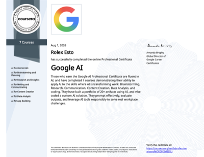

<!-- Palette: Fabric Teal  #00C389 → #0EA5E9  on #0D1117 -->

<picture>
  
</picture>

 

## <picture><source media="(prefers-color-scheme: dark)" srcset="https://api.iconify.design/pixelarticons/user.svg?color=%2300C389"><source media="(prefers-color-scheme: light)" srcset="https://api.iconify.design/pixelarticons/user.svg?color=%2300A06E"></picture> About Me

**I’m a 4th-year BSIT student building practical, production-ready solutions across web development, AI, data, and cloud technologies.**

- <picture><source media="(prefers-color-scheme: dark)" srcset="https://api.iconify.design/pixel/graduation-cap-solid.svg?color=%2300C389"><source media="(prefers-color-scheme: light)" srcset="https://api.iconify.design/pixel/graduation-cap-solid.svg?color=%2300A06E"></picture> 4th-year BSIT student at **STI College Fairview** (September 2023 – July 2027)
- <picture><source media="(prefers-color-scheme: dark)" srcset="https://api.iconify.design/pixelarticons/database.svg?color=%2300C389"><source media="(prefers-color-scheme: light)" srcset="https://api.iconify.design/pixelarticons/database.svg?color=%2300A06E"></picture> **Eskwelabs Innovation Fellowship (EIF)**, Cohort 11 · **GCI World 2026** participant at the University of Tokyo
- <picture><source media="(prefers-color-scheme: dark)" srcset="https://api.iconify.design/pixelarticons/shield.svg?color=%2300C389"><source media="(prefers-color-scheme: light)" srcset="https://api.iconify.design/pixelarticons/shield.svg?color=%2300A06E"></picture> **DICT-Recognized Cybersecurity Professional**, Category 2 (Intermediate)
- <picture><source media="(prefers-color-scheme: dark)" srcset="https://api.iconify.design/pixelarticons/compass.svg?color=%2300C389"><source media="(prefers-color-scheme: light)" srcset="https://api.iconify.design/pixelarticons/compass.svg?color=%2300A06E"></picture> 4× hackathon top finishes, including **OpsPilot**, **Weather Weather Lang**, **BahaRoute**, and **SmartWatts**

> <picture><source media="(prefers-color-scheme: dark)" srcset="https://api.iconify.design/pixelarticons/search.svg?color=%2300C389"><source media="(prefers-color-scheme: light)" srcset="https://api.iconify.design/pixelarticons/search.svg?color=%2300A06E"></picture> **Working on:** BizPilot · TAPME client websites and NFC pages · Microsoft Fabric data pipelines
>
> <picture><source media="(prefers-color-scheme: dark)" srcset="https://api.iconify.design/pixelarticons/zap.svg?color=%230EA5E9"><source media="(prefers-color-scheme: light)" srcset="https://api.iconify.design/pixelarticons/zap.svg?color=%230284C7"></picture> **Focus:** practical solutions across web development, AI, data, and cloud

## <picture><source media="(prefers-color-scheme: dark)" srcset="https://api.iconify.design/pixelarticons/flag.svg?color=%2300C389"><source media="(prefers-color-scheme: light)" srcset="https://api.iconify.design/pixelarticons/flag.svg?color=%2300A06E"></picture> Trophy Wall

**4× Hackathon Top Finishes**

<table>
<tr><th width="56"></th><th>Result</th><th>Event</th><th>Project / Role</th></tr>
<tr><td align="center" width="56"><picture><source media="(prefers-color-scheme: dark)" srcset="https://api.iconify.design/pixelarticons/trophy.svg?color=%2300C389"><source media="(prefers-color-scheme: light)" srcset="https://api.iconify.design/pixelarticons/trophy.svg?color=%2300A06E"></picture></td><td><b>Top 2 Winner</b></td><td>DevKada × ClankerCloud Build Challenge (August 24–29, 2026)</td><td><a href="https://github.com/rolex-esto/opspilot">OpsPilot</a> · Solo Developer</td></tr>
<tr><td align="center" width="56"><picture><source media="(prefers-color-scheme: dark)" srcset="https://api.iconify.design/pixel/badge-check-solid.svg?color=%2300C389"><source media="(prefers-color-scheme: light)" srcset="https://api.iconify.design/pixel/badge-check-solid.svg?color=%2300A06E"></picture></td><td><b>3rd Place</b></td><td>KiroVerse Hack Sprint (AWS &amp; RevenueCat, June – August 2026)</td><td><a href="https://github.com/rolex-esto/Kirovers-Hack-Sprint-Shipaton-Edition">Weather Weather Lang</a> · AI Orchestrator</td></tr>
<tr><td align="center" width="56"><picture><source media="(prefers-color-scheme: dark)" srcset="https://api.iconify.design/pixelarticons/target.svg?color=%2300C389"><source media="(prefers-color-scheme: light)" srcset="https://api.iconify.design/pixelarticons/target.svg?color=%2300A06E"></picture></td><td><b>Top 10 Finalist</b></td><td>Meralco IDOL Hackathon · Meralco Power Academy (November 12–13, 2026)</td><td><b>Team KuryenTech</b> · Lead Developer</td></tr>
<tr><td align="center" width="56"><picture><source media="(prefers-color-scheme: dark)" srcset="https://api.iconify.design/pixelarticons/star.svg?color=%2300C389"><source media="(prefers-color-scheme: light)" srcset="https://api.iconify.design/pixelarticons/star.svg?color=%2300A06E"></picture></td><td><b>Top 36 Team · Top 10 Climate Change Track</b></td><td>BuildOvernights KiroxHackaton (AWS Office, October 3–4, 2026)</td><td><a href="https://github.com/rolex-esto/KiroxQuick_Flood_CTRL">BahaRoute</a> · Lead Developer</td></tr>
</table>

## <picture><source media="(prefers-color-scheme: dark)" srcset="https://api.iconify.design/pixel/plane-departure-solid.svg?color=%2300C389"><source media="(prefers-color-scheme: light)" srcset="https://api.iconify.design/pixel/plane-departure-solid.svg?color=%2300A06E"></picture> Featured Projects

<table>
<tr>
<td width="50%" valign="top">

### BizPilot
**MSME operations platform** · Founder & Developer · Active development

One place for Filipino online sellers to manage customer messages, orders, stock, and daily operations, with an AI sales assistant and a shared operations calendar.

[**Live →**](https://biz-pilot-msme.vercel.app/) · <picture><source media="(prefers-color-scheme: dark)" srcset="https://api.iconify.design/pixelarticons/lock.svg?color=%230EA5E9"><source media="(prefers-color-scheme: light)" srcset="https://api.iconify.design/pixelarticons/lock.svg?color=%230284C7"></picture> Private repository

</td>
<td width="50%" valign="top">

### SmartWatts <picture><source media="(prefers-color-scheme: dark)" srcset="https://api.iconify.design/pixelarticons/trophy.svg?color=%2300C389"><source media="(prefers-color-scheme: light)" srcset="https://api.iconify.design/pixelarticons/trophy.svg?color=%2300A06E"></picture>
**Electricity use information and tracking tool** · Top 10 Finalist, Meralco IDOL Hackathon · Lead Developer, Team KuryenTech

Helps households understand electricity use with bill scanning, appliance tracking, usage trends, estimates, and practical suggestions. SmartWatts Personal includes goals, challenges, rewards, and an AI advisor in English and Tagalog.

</td>
</tr>
<tr>
<td width="50%" valign="top">

### OpsPilot <picture><source media="(prefers-color-scheme: dark)" srcset="https://api.iconify.design/pixelarticons/trophy.svg?color=%2300C389"><source media="(prefers-color-scheme: light)" srcset="https://api.iconify.design/pixelarticons/trophy.svg?color=%2300A06E"></picture>
**AI DevOps incident investigator** · Top 2 Winner, DevKada x ClankerCloud Build Challenge · Solo Developer

Helps tech teams find the cause of system outages and make decisions from evidence during incidents.

[**Repo →**](https://github.com/rolex-esto/opspilot)

</td>
<td width="50%" valign="top">

### BahaRoute <picture><source media="(prefers-color-scheme: dark)" srcset="https://api.iconify.design/pixelarticons/star.svg?color=%2300C389"><source media="(prefers-color-scheme: light)" srcset="https://api.iconify.design/pixelarticons/star.svg?color=%2300A06E"></picture>
**Flood-aware route helper for Metro Manila** · Top 10 Climate Change Track · Lead Developer

Helps drivers avoid flood-prone roads with flood history, rainfall forecasts, and spoken hazard alerts.

[**Repo →**](https://github.com/rolex-esto/KiroxQuick_Flood_CTRL) · [**Live →**](https://baha-route.vercel.app/)

</td>
</tr>
<tr>
<td width="50%" valign="top">

### Weather Weather Lang <picture><source media="(prefers-color-scheme: dark)" srcset="https://api.iconify.design/pixel/badge-check-solid.svg?color=%2300C389"><source media="(prefers-color-scheme: light)" srcset="https://api.iconify.design/pixel/badge-check-solid.svg?color=%2300A06E"></picture>
**Conversational weather companion** · 3rd Place, KiroVerse Hack Sprint · AI Orchestrator, team project

Gives people friendly weather updates in a chat-style experience.

[**Team repo →**](https://github.com/rolex-esto/Kirovers-Hack-Sprint-Shipaton-Edition) · [**Live →**](https://kiroverse-hack-sprint-shipaton-edition.vercel.app/)

</td>
<td width="50%" valign="top">

### Ulan Ba?
**Philippine rain forecast dashboard** · Creator & Frontend Developer

Helps people plan trips and outdoor activities with hourly rain and severity forecasts for 17 regions and 150+ cities.

[**Repo →**](https://github.com/rolex-esto/kiro-phWeather)

</td>
</tr>
<tr>
<td width="50%" valign="top">

### Classic Flagship Store
**E-commerce capstone project**

An online store with separate admin, cashier, and customer dashboards to make inventory and daily store operations easier.

[**Site →**](https://classicflagshipstore.com/) · <picture><source media="(prefers-color-scheme: dark)" srcset="https://api.iconify.design/pixelarticons/lock.svg?color=%230EA5E9"><source media="(prefers-color-scheme: light)" srcset="https://api.iconify.design/pixelarticons/lock.svg?color=%230284C7"></picture> Private repository

</td>
<td width="50%" valign="top">

### TAPME
**Freelance web development** · 2025 – Present

Builds NFC pages and client websites that help businesses share their details and collect reviews.

[**Website →**](https://tapmeph.com/)

</td>
</tr>
</table>

<b><picture><source media="(prefers-color-scheme: dark)" srcset="https://api.iconify.design/pixelarticons/book-open.svg?color=%2300C389"><source media="(prefers-color-scheme: light)" srcset="https://api.iconify.design/pixelarticons/book-open.svg?color=%2300A06E"></picture> Project details</b>

 

**BizPilot** — Gives Filipino online sellers one inbox for social messages, one-click ordering in conversations, stock management, and a shared operations calendar. It includes an AI sales assistant and keeps each seller’s data private.

**SmartWatts** — An informational and tracking tool that helps households understand electricity use through bills, appliance records, meter readings, trends, estimates, and practical suggestions. SmartWatts Rentals helps property managers organize units, invite tenants, record readings, and prepare electricity statements, giving managers and tenants a shared view of unit usage.

**OpsPilot** — Helps tech teams investigate system outages using evidence and makes clear when the cause has not yet been confirmed.

**BahaRoute** — Helps Metro Manila drivers choose routes away from flooded roads across 17 cities and 1,710 barangays, using Project NOAH flood history, live rainfall forecasts, and spoken hazard alerts.

**Weather Weather Lang** — A chat-style weather companion that gives people weather updates in a friendly, conversational way.

**Ulan Ba?** — Helps Filipinos plan travel and outdoor activities around expected rainfall, with hourly rain and severity forecasts for 17 regions and 150+ cities and automatic location detection.

**Classic Flagship Store** — An online store for Classic Flagship Store with separate admin, cashier, and customer dashboards, secure Google sign-in, and inventory tools.

## <picture><source media="(prefers-color-scheme: dark)" srcset="https://api.iconify.design/pixelarticons/briefcase.svg?color=%2300C389"><source media="(prefers-color-scheme: light)" srcset="https://api.iconify.design/pixelarticons/briefcase.svg?color=%2300A06E"></picture> Experience

| Role | Organization | Period |
|---|---|---|
| **Freelance Web Developer** | [TAPME](https://tapmeph.com/) | 2025 – Present |
| **Startup Founder & Developer** | BizPilot | Active development |
| **Data Innovation Fellow**, Cohort 11 | Eskwelabs Innovation Fellowship (EIF) | August 2026 – November 2026 |
| **Participant**, Data Science & AI | GCI World 2026 · Matsuo-Iwasawa Laboratory, University of Tokyo | September 2026 – November 2026 |
| **BSIT student** | STI College Fairview, Quezon City, PH | September 2023 – July 2027 |

<b>What I do at TAPME</b>

 

- Build the pages that open when customers tap TAPME NFC products, including digital calling cards, Google Review and social media tap pages, menus, and brochures.
- Develop client websites for TAPME packages, from showcase sites to sites with admin tools owners can manage.
- Make sure every tap or QR scan opens cleanly on any phone.

<b>Fellowships & Professional Training</b>

 

**Eskwelabs Innovation Fellowship (EIF)** — Selected for Cohort 11’s Data Innovation track, collaborating on projects across analytics, data modeling, strategy and management, and learning experience design (August 2026 – November 2026).

**GCI World 2026** — Completed a global data science and AI program under the Matsuo-Iwasawa Laboratory, University of Tokyo, applying data-driven methods and intelligent systems to real-world software and data engineering projects (September 2026 – November 2026).

**Completed professional tracks:** AWS SimuLearn Cloud Practitioner (July 2026) · Microsoft DP-900, DP-700 and PL-300 curriculum tracks (July – October 2026) · DICT Region V Data Privacy Protection Competency Framework, 20-Hour Intensive Training (June 2026).

## <picture><source media="(prefers-color-scheme: dark)" srcset="https://api.iconify.design/pixelarticons/tools.svg?color=%2300C389"><source media="(prefers-color-scheme: light)" srcset="https://api.iconify.design/pixelarticons/tools.svg?color=%2300A06E"></picture> Tech Stack

**Languages** 
 

**Web Technologies & Frameworks** 
 OAuth

**Databases & Data** 
 
      Recharts

**Cloud & Security** 
  IAM

**Tools & AI** 
 
     Codex

## <picture><source media="(prefers-color-scheme: dark)" srcset="https://api.iconify.design/pixelarticons/notes.svg?color=%2300C389"><source media="(prefers-color-scheme: light)" srcset="https://api.iconify.design/pixelarticons/notes.svg?color=%2300A06E"></picture> Certifications

  
  
  
  
  
  

<table width="100%">
<tr>
<td width="46%" align="center" valign="middle">

</td>
<td valign="middle">

 

### Microsoft Certified: Fabric Data Engineer Associate

**DP-700** · Earned Nov 2026 · Valid until Nov 10, 2027

<picture><source media="(prefers-color-scheme: dark)" srcset="https://api.iconify.design/pixelarticons/external-link.svg?color=%2300C389"><source media="(prefers-color-scheme: light)" srcset="https://api.iconify.design/pixelarticons/external-link.svg?color=%2300A06E"></picture> [**Verify on Microsoft Learn**](https://learn.microsoft.com/en-us/users/rolexesto-7021/credentials/certification/fabric-data-engineer-associate?tab=credentials-tab) · <picture><source media="(prefers-color-scheme: dark)" srcset="https://api.iconify.design/pixelarticons/expand.svg?color=%2300C389"><source media="(prefers-color-scheme: light)" srcset="https://api.iconify.design/pixelarticons/expand.svg?color=%2300A06E"></picture> [Full certificate](assets/certs/dp700.png)

</td>
</tr>
</table>

<b><picture><source media="(prefers-color-scheme: dark)" srcset="https://api.iconify.design/pixelarticons/window-frame.svg?color=%2300C389"><source media="(prefers-color-scheme: light)" srcset="https://api.iconify.design/pixelarticons/window-frame.svg?color=%2300A06E"></picture> Microsoft &amp; Cloud</b> · 1 certification · 1 training

 

<table width="100%">
<tr><td align="center" valign="top" width="400"> <b>Microsoft Certified: Fabric Data Engineer Associate (DP-700)</b> <picture><source media="(prefers-color-scheme: dark)" srcset="https://api.iconify.design/pixelarticons/window-frame.svg?color=%2300C389"><source media="(prefers-color-scheme: light)" srcset="https://api.iconify.design/pixelarticons/window-frame.svg?color=%2300A06E"></picture> Microsoft · Nov 2026 Valid until Nov 10, 2027</td><td align="center" valign="top" width="400"> <b>AWS SimuLearn: Cloud Practitioner</b> <picture><source media="(prefers-color-scheme: dark)" srcset="https://api.iconify.design/pixelarticons/cloud.svg?color=%2300C389"><source media="(prefers-color-scheme: light)" srcset="https://api.iconify.design/pixelarticons/cloud.svg?color=%2300A06E"></picture> AWS · Jul 2026 <b>Training</b> · completion certificate</td></tr>
</table>

<b><picture><source media="(prefers-color-scheme: dark)" srcset="https://api.iconify.design/pixelarticons/database.svg?color=%2300C389"><source media="(prefers-color-scheme: light)" srcset="https://api.iconify.design/pixelarticons/database.svg?color=%2300A06E"></picture> Data</b> · 4 certifications

 

<table width="100%">
<tr><td align="center" valign="top" width="400"> <b>DataCamp Certified Associate Data Engineer</b> <picture><source media="(prefers-color-scheme: dark)" srcset="https://api.iconify.design/pixelarticons/analytics.svg?color=%2300C389"><source media="(prefers-color-scheme: light)" srcset="https://api.iconify.design/pixelarticons/analytics.svg?color=%2300A06E"></picture> DataCamp · Jul 2026</td><td align="center" valign="top" width="400"> <b>DataCamp Certified Associate Data Analyst</b> <picture><source media="(prefers-color-scheme: dark)" srcset="https://api.iconify.design/pixelarticons/analytics.svg?color=%2300C389"><source media="(prefers-color-scheme: light)" srcset="https://api.iconify.design/pixelarticons/analytics.svg?color=%2300A06E"></picture> DataCamp · May 2026</td></tr>
<tr><td align="center" valign="top" width="400"> <b>DataCamp Certified SQL Associate</b> <picture><source media="(prefers-color-scheme: dark)" srcset="https://api.iconify.design/pixelarticons/analytics.svg?color=%2300C389"><source media="(prefers-color-scheme: light)" srcset="https://api.iconify.design/pixelarticons/analytics.svg?color=%2300A06E"></picture> DataCamp · Apr 2026</td><td align="center" valign="top" width="400"> <b>DataCamp Certified in Data Literacy</b> <picture><source media="(prefers-color-scheme: dark)" srcset="https://api.iconify.design/pixelarticons/analytics.svg?color=%2300C389"><source media="(prefers-color-scheme: light)" srcset="https://api.iconify.design/pixelarticons/analytics.svg?color=%2300A06E"></picture> DataCamp · Jul 2026</td></tr>
</table>

<b><picture><source media="(prefers-color-scheme: dark)" srcset="https://api.iconify.design/pixelarticons/shield.svg?color=%2300C389"><source media="(prefers-color-scheme: light)" srcset="https://api.iconify.design/pixelarticons/shield.svg?color=%2300A06E"></picture> Security</b> · 3 certifications · 1 recognition

 

<table width="100%">
<tr><td align="center" valign="top" width="400"> <b>Certified in Cybersecurity (CC)</b> <picture><source media="(prefers-color-scheme: dark)" srcset="https://api.iconify.design/pixelarticons/shield.svg?color=%2300C389"><source media="(prefers-color-scheme: light)" srcset="https://api.iconify.design/pixelarticons/shield.svg?color=%2300A06E"></picture> ISC2 · Mar 2026 Cycle: Mar 2026 – Feb 2029</td><td align="center" valign="top" width="400"> <b>DICT-Recognized Cybersecurity Professional, Category 2</b> <picture><source media="(prefers-color-scheme: dark)" srcset="https://api.iconify.design/pixelarticons/shield.svg?color=%2300C389"><source media="(prefers-color-scheme: light)" srcset="https://api.iconify.design/pixelarticons/shield.svg?color=%2300A06E"></picture> DICT · Sep 2026 Professional recognition</td></tr>
<tr><td align="center" valign="top" width="400"> <b>Certified Cybersecurity Professional (CCP)</b> <picture><source media="(prefers-color-scheme: dark)" srcset="https://api.iconify.design/pixel/badge-check-solid.svg?color=%2300C389"><source media="(prefers-color-scheme: light)" srcset="https://api.iconify.design/pixel/badge-check-solid.svg?color=%2300A06E"></picture> Appkademiya · Aug 2026</td><td align="center" valign="top" width="400"> <b>Certified Threat Intelligence &amp; Governance Analyst (CTIGA)</b> <picture><source media="(prefers-color-scheme: dark)" srcset="https://api.iconify.design/pixelarticons/shield.svg?color=%2300C389"><source media="(prefers-color-scheme: light)" srcset="https://api.iconify.design/pixelarticons/shield.svg?color=%2300A06E"></picture> Red Team Leaders · Jan 2026</td></tr>
</table>

<b><picture><source media="(prefers-color-scheme: dark)" srcset="https://api.iconify.design/pixelarticons/sparkles.svg?color=%2300C389"><source media="(prefers-color-scheme: light)" srcset="https://api.iconify.design/pixelarticons/sparkles.svg?color=%2300A06E"></picture> AI</b> · 1 certification

 

<table width="100%">
<tr><td align="center" valign="top" width="400"> <b>Google AI Professional Certificate</b> <picture><source media="(prefers-color-scheme: dark)" srcset="https://api.iconify.design/pixelarticons/google.svg?color=%2300C389"><source media="(prefers-color-scheme: light)" srcset="https://api.iconify.design/pixelarticons/google.svg?color=%2300A06E"></picture> Google · Aug 2026</td></tr>
</table>

<b><picture><source media="(prefers-color-scheme: dark)" srcset="https://api.iconify.design/pixelarticons/clock.svg?color=%2300C389"><source media="(prefers-color-scheme: light)" srcset="https://api.iconify.design/pixelarticons/clock.svg?color=%2300A06E"></picture> Certification journey</b> · January 2026 → November 2026

 

| Date | Milestone |
|---|---|
| **January 2026** | Red Team Leaders Certified Threat Intelligence &amp; Governance Analyst (CTIGA) |
| **March 2026** | ISC2 Certified in Cybersecurity (CC) |
| **April 2026** | DataCamp Certified SQL Associate |
| **May 2026** | DataCamp Certified Associate Data Analyst |
| **June 2026** | DICT Region V Data Privacy Protection Competency Framework, 20-Hour Intensive Training |
| **July 2026** | DataCamp Certified Associate Data Engineer · DataCamp Certified in Data Literacy · AWS SimuLearn Cloud Practitioner · Microsoft DP-900 curriculum track |
| **August 2026** | Google AI Professional Certificate · Appkademiya Certified Cybersecurity Professional (CCP) · Microsoft DP-700 curriculum track |
| **September 2026** | DICT-Recognized Cybersecurity Professional Category 2 (Intermediate) |
| **October 2026** | Microsoft PL-300 Power BI Data Analyst curriculum track |
| **November 2026** | Microsoft Certified: Fabric Data Engineer Associate (DP-700) |

Only the DP-700 has a verification link; every other thumbnail opens the full-size certificate image. DICT Category 2 is a professional recognition, not an exam certificate. AWS SimuLearn, the Microsoft curriculum tracks and DICT Region V are training.

## <picture><source media="(prefers-color-scheme: dark)" srcset="https://api.iconify.design/pixelarticons/users.svg?color=%2300C389"><source media="(prefers-color-scheme: light)" srcset="https://api.iconify.design/pixelarticons/users.svg?color=%2300A06E"></picture> Leadership & Affiliations

<b>Roles & affiliations</b>

 

- <picture><source media="(prefers-color-scheme: dark)" srcset="https://api.iconify.design/pixelarticons/library.svg?color=%2300C389"><source media="(prefers-color-scheme: light)" srcset="https://api.iconify.design/pixelarticons/library.svg?color=%2300A06E"></picture> **Founding President**, Microsoft Student Community, STI Fairview
- <picture><source media="(prefers-color-scheme: dark)" srcset="https://api.iconify.design/pixelarticons/cloud.svg?color=%2300C389"><source media="(prefers-color-scheme: light)" srcset="https://api.iconify.design/pixelarticons/cloud.svg?color=%2300A06E"></picture> **AWS Learning Club Lead**, AWS Student User Group Philippines
- <picture><source media="(prefers-color-scheme: dark)" srcset="https://api.iconify.design/pixelarticons/mic.svg?color=%2300C389"><source media="(prefers-color-scheme: light)" srcset="https://api.iconify.design/pixelarticons/mic.svg?color=%2300A06E"></picture> **Delegate / Representative**, Data Engineering Pilipinas x Echelon 2026 by Brainsparks (August 25–26, 2026)
- <picture><source media="(prefers-color-scheme: dark)" srcset="https://api.iconify.design/pixel/handshake-solid.svg?color=%2300C389"><source media="(prefers-color-scheme: light)" srcset="https://api.iconify.design/pixel/handshake-solid.svg?color=%2300A06E"></picture> **Venue Partnerships Associate**, Seekers Guild (August 2026 – November 2026)

**Affiliations:** ISC2 Philippines Chapter · Data Engineering Pilipinas × DataCamp Donates (Scholar) · STI Fairview Bytes · STI Alumni Scholarship · DTI Metro Manila × Google Career Certificate Scholar · Cisco NetConnect PUP – Manila (Cybersecurity Operations)

## <picture><source media="(prefers-color-scheme: dark)" srcset="https://api.iconify.design/pixelarticons/chart.svg?color=%2300C389"><source media="(prefers-color-scheme: light)" srcset="https://api.iconify.design/pixelarticons/chart.svg?color=%2300A06E"></picture> GitHub Stats

  <picture>
    <source media="(prefers-color-scheme: dark)" srcset="https://github-readme-stats-fast.vercel.app/api?username=rolex-esto&show_icons=true&hide_border=true&bg_color=0D1117&title_color=00C389&icon_color=0EA5E9&text_color=C9D1D9">
    <source media="(prefers-color-scheme: light)" srcset="https://github-readme-stats-fast.vercel.app/api?username=rolex-esto&show_icons=true&hide_border=true&bg_color=FFFFFF&title_color=00A06E&icon_color=0284C7&text_color=24292F">
    
  </picture>
  <picture>
    <source media="(prefers-color-scheme: dark)" srcset="https://github-readme-stats-fast.vercel.app/api/top-langs/?username=rolex-esto&layout=compact&hide_border=true&bg_color=0D1117&title_color=00C389&text_color=C9D1D9">
    <source media="(prefers-color-scheme: light)" srcset="https://github-readme-stats-fast.vercel.app/api/top-langs/?username=rolex-esto&layout=compact&hide_border=true&bg_color=FFFFFF&title_color=00A06E&text_color=24292F">
    
  </picture>

  <picture>
    <source media="(prefers-color-scheme: dark)" srcset="https://streak-stats.demolab.com/?user=rolex-esto&hide_border=true&background=0D1117&ring=00C389&fire=0EA5E9&currStreakLabel=00C389&sideLabels=C9D1D9&currStreakNum=C9D1D9&sideNums=C9D1D9&dates=8B949E">
    <source media="(prefers-color-scheme: light)" srcset="https://streak-stats.demolab.com/?user=rolex-esto&hide_border=true&background=FFFFFF&ring=00A06E&fire=0284C7&currStreakLabel=00A06E&sideLabels=24292F&currStreakNum=24292F&sideNums=24292F&dates=57606A">
    
  </picture>

  <picture>
    <source media="(prefers-color-scheme: dark)" srcset="https://raw.githubusercontent.com/rolex-esto/rolex-esto/output/github-snake-dark.svg">
    <source media="(prefers-color-scheme: light)" srcset="https://raw.githubusercontent.com/rolex-esto/rolex-esto/output/github-snake.svg">
    
  </picture>

## <picture><source media="(prefers-color-scheme: dark)" srcset="https://api.iconify.design/pixelarticons/mail.svg?color=%2300C389"><source media="(prefers-color-scheme: light)" srcset="https://api.iconify.design/pixelarticons/mail.svg?color=%2300A06E"></picture> Let's Connect

I'm most interested in opportunities where I can build, experiment, ship, and learn from real-world problems.

<picture><source media="(prefers-color-scheme: dark)" srcset="https://api.iconify.design/pixelarticons/globe.svg?color=%2300C389"><source media="(prefers-color-scheme: light)" srcset="https://api.iconify.design/pixelarticons/globe.svg?color=%2300A06E"></picture> [Portfolio](https://rolex-esto.vercel.app/) · <picture><source media="(prefers-color-scheme: dark)" srcset="https://api.iconify.design/pixelarticons/linkedin.svg?color=%2300C389"><source media="(prefers-color-scheme: light)" srcset="https://api.iconify.design/pixelarticons/linkedin.svg?color=%2300A06E"></picture> [LinkedIn](https://linkedin.com/in/rolex-esto-1b33b2391/) · <picture><source media="(prefers-color-scheme: dark)" srcset="https://api.iconify.design/pixelarticons/mail.svg?color=%2300C389"><source media="(prefers-color-scheme: light)" srcset="https://api.iconify.design/pixelarticons/mail.svg?color=%2300A06E"></picture> [Email](mailto:rolexesto0001@gmail.com) · <picture><source media="(prefers-color-scheme: dark)" srcset="https://api.iconify.design/pixelarticons/github.svg?color=%2300C389"><source media="(prefers-color-scheme: light)" srcset="https://api.iconify.design/pixelarticons/github.svg?color=%2300A06E"></picture> [GitHub](https://github.com/rolex-esto)

