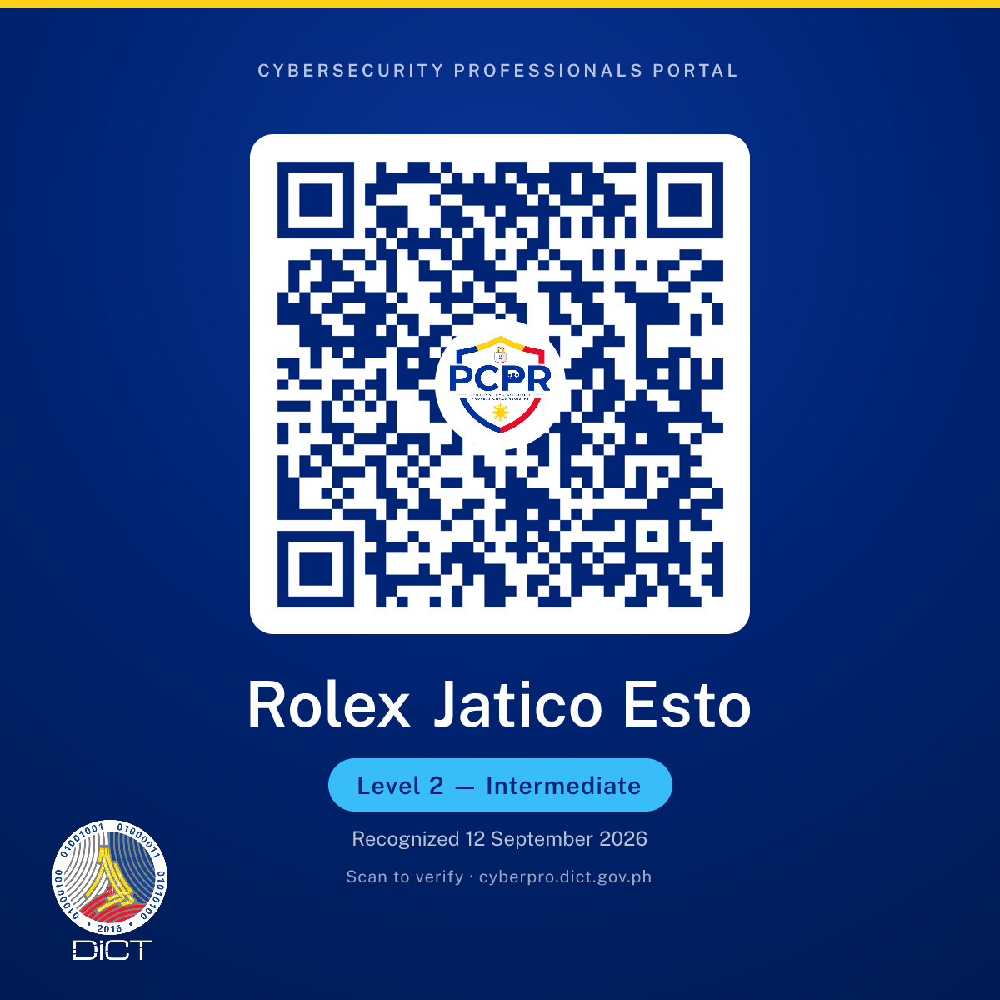

<!-- Palette: Fabric Teal  #00C389 → #0EA5E9  on #0D1117 -->

<picture>
  
</picture>

 

## <picture><source media="(prefers-color-scheme: dark)" srcset="https://api.iconify.design/lucide/user-round.svg?color=%2300C389"><source media="(prefers-color-scheme: light)" srcset="https://api.iconify.design/lucide/user-round.svg?color=%2300A06E"></picture> About Me

**I build software for people who have an idea and need it to exist.**

- <picture><source media="(prefers-color-scheme: dark)" srcset="https://api.iconify.design/lucide/graduation-cap.svg?color=%2300C389"><source media="(prefers-color-scheme: light)" srcset="https://api.iconify.design/lucide/graduation-cap.svg?color=%2300A06E"></picture> 4th-year BS Information Technology student at **STI College Fairview**
- <picture><source media="(prefers-color-scheme: dark)" srcset="https://api.iconify.design/lucide/database.svg?color=%2300C389"><source media="(prefers-color-scheme: light)" srcset="https://api.iconify.design/lucide/database.svg?color=%2300A06E"></picture> **Data Innovation Fellow**, Eskwelabs Cohort 11 · **GCI World 2026** participant (Data Science & AI, Matsuo-Iwasawa Lab, University of Tokyo)
- <picture><source media="(prefers-color-scheme: dark)" srcset="https://api.iconify.design/lucide/shield-check.svg?color=%2300C389"><source media="(prefers-color-scheme: light)" srcset="https://api.iconify.design/lucide/shield-check.svg?color=%2300A06E"></picture> **DICT-Recognized Cybersecurity Professional**, Category 2 (Intermediate)
- <picture><source media="(prefers-color-scheme: dark)" srcset="https://api.iconify.design/lucide/compass.svg?color=%2300C389"><source media="(prefers-color-scheme: light)" srcset="https://api.iconify.design/lucide/compass.svg?color=%2300A06E"></picture> I start from real problems: a seller drowning in messages, a team debugging a production incident, a commuter deciding whether to travel

> <picture><source media="(prefers-color-scheme: dark)" srcset="https://api.iconify.design/lucide/telescope.svg?color=%2300C389"><source media="(prefers-color-scheme: light)" srcset="https://api.iconify.design/lucide/telescope.svg?color=%2300A06E"></picture> **Working on:** BizPilot · Eskwelabs Data Innovation Fellowship · Microsoft Fabric data pipelines · Freelance Web Developer @ TAPME
>
> <picture><source media="(prefers-color-scheme: dark)" srcset="https://api.iconify.design/lucide/zap.svg?color=%230EA5E9"><source media="(prefers-color-scheme: light)" srcset="https://api.iconify.design/lucide/zap.svg?color=%230284C7"></picture> **Fun fact:** I built a flood-routing app in 12 hours

## <picture><source media="(prefers-color-scheme: dark)" srcset="https://api.iconify.design/lucide/trophy.svg?color=%2300C389"><source media="(prefers-color-scheme: light)" srcset="https://api.iconify.design/lucide/trophy.svg?color=%2300A06E"></picture> Trophy Wall

**4× Hackathon Top Finishes**

<table>
<tr><th width="56"></th><th>Result</th><th>Event</th><th>Project / Role</th></tr>
<tr><td align="center" width="56"><picture><source media="(prefers-color-scheme: dark)" srcset="https://api.iconify.design/lucide/medal.svg?color=%2300C389"><source media="(prefers-color-scheme: light)" srcset="https://api.iconify.design/lucide/medal.svg?color=%2300A06E"></picture></td><td><b>Top 2 Winner</b></td><td>DevKada × ClankerCloud Build Challenge</td><td><a href="https://github.com/rolex-esto/opspilot">OpsPilot</a></td></tr>
<tr><td align="center" width="56"><picture><source media="(prefers-color-scheme: dark)" srcset="https://api.iconify.design/lucide/award.svg?color=%2300C389"><source media="(prefers-color-scheme: light)" srcset="https://api.iconify.design/lucide/award.svg?color=%2300A06E"></picture></td><td><b>3rd Place</b></td><td>KiroVerse Hack Sprint: Shipaton Edition (AWS &amp; RevenueCat)</td><td><a href="https://github.com/rolex-esto/Kirovers-Hack-Sprint-Shipaton-Edition">Weather Weather Lang</a> · AI Orchestrator</td></tr>
<tr><td align="center" width="56"><picture><source media="(prefers-color-scheme: dark)" srcset="https://api.iconify.design/lucide/target.svg?color=%2300C389"><source media="(prefers-color-scheme: light)" srcset="https://api.iconify.design/lucide/target.svg?color=%2300A06E"></picture></td><td><b>Top 10 Finalist</b></td><td>Meralco IDOL Hackathon 2026 (Meralco Power Academy)</td><td>Team <b>KuryenTech</b> · Lead Developer</td></tr>
<tr><td align="center" width="56"><picture><source media="(prefers-color-scheme: dark)" srcset="https://api.iconify.design/lucide/star.svg?color=%2300C389"><source media="(prefers-color-scheme: light)" srcset="https://api.iconify.design/lucide/star.svg?color=%2300A06E"></picture></td><td><b>Top 10 Climate Change Track / Top 36 overall</b></td><td>BuildOvernights Kiro × Hackathon (AWS HQ, BGC)</td><td><a href="https://github.com/rolex-esto/KiroxQuick_Flood_CTRL">BahaRoute</a></td></tr>
</table>

## <picture><source media="(prefers-color-scheme: dark)" srcset="https://api.iconify.design/lucide/rocket.svg?color=%2300C389"><source media="(prefers-color-scheme: light)" srcset="https://api.iconify.design/lucide/rocket.svg?color=%2300A06E"></picture> Featured Projects

<table>
<tr>
<td width="50%" valign="top">

### BizPilot
**MSME operations platform** · Founder & Developer

Unified social inbox, grounded AI sales assistant, 1-click conversational orders, real-time ops calendar sync.

<picture><source media="(prefers-color-scheme: dark)" srcset="https://api.iconify.design/lucide/lock.svg?color=%230EA5E9"><source media="(prefers-color-scheme: light)" srcset="https://api.iconify.design/lucide/lock.svg?color=%230284C7"></picture> Private repository

</td>
<td width="50%" valign="top">

### OpsPilot <picture><source media="(prefers-color-scheme: dark)" srcset="https://api.iconify.design/lucide/medal.svg?color=%2300C389"><source media="(prefers-color-scheme: light)" srcset="https://api.iconify.design/lucide/medal.svg?color=%2300A06E"></picture>
**AI DevOps incident investigator**

Evidence-first loop: Scan → Hypothesize → Test → Reassess → Remediate → Verify → Validate.

[**Repo →**](https://github.com/rolex-esto/opspilot)

</td>
</tr>
<tr>
<td width="50%" valign="top">

### BahaRoute <picture><source media="(prefers-color-scheme: dark)" srcset="https://api.iconify.design/lucide/star.svg?color=%2300C389"><source media="(prefers-color-scheme: light)" srcset="https://api.iconify.design/lucide/star.svg?color=%2300A06E"></picture>
**Flood-aware routing for Metro Manila**

17 cities, 1,710 barangays, Project NOAH data, live rainfall, voice hazard alerts. Built in 12 hours.

[**Repo →**](https://github.com/rolex-esto/KiroxQuick_Flood_CTRL)

</td>
<td width="50%" valign="top">

### Weather Weather Lang <picture><source media="(prefers-color-scheme: dark)" srcset="https://api.iconify.design/lucide/award.svg?color=%2300C389"><source media="(prefers-color-scheme: light)" srcset="https://api.iconify.design/lucide/award.svg?color=%2300A06E"></picture>
**Conversational weather companion**

AI orchestrator delegating to Kiro agents, with loop-engineered quality checks.

[**Repo →**](https://github.com/rolex-esto/Kirovers-Hack-Sprint-Shipaton-Edition) · [**Live →**](https://kiroverse-hack-sprint-shipaton-edition.vercel.app/)

</td>
</tr>
<tr>
<td width="50%" valign="top">

### Ulan Ba?
**PH rain forecast dashboard**

React, TypeScript, Vite, Recharts, Open-Meteo. 17 regions, 150+ cities, "Best Time to Go", typhoon alerts.

[**Repo →**](https://github.com/rolex-esto/kiro-phWeather) · [**Live →**](https://kiro-ph-weather.vercel.app)

</td>
<td width="50%" valign="top">

### Classic Flagship Store
**E-commerce capstone**

PHP, MySQL, PDO, Google OAuth, Gemini AI, PHPMailer, Hostinger. Role-based dashboards, SQLi protection, SPF/DKIM/DMARC.

<picture><source media="(prefers-color-scheme: dark)" srcset="https://api.iconify.design/lucide/lock.svg?color=%230EA5E9"><source media="(prefers-color-scheme: light)" srcset="https://api.iconify.design/lucide/lock.svg?color=%230284C7"></picture> Private repository

</td>
</tr>
</table>

<b><picture><source media="(prefers-color-scheme: dark)" srcset="https://api.iconify.design/lucide/book-open.svg?color=%2300C389"><source media="(prefers-color-scheme: light)" srcset="https://api.iconify.design/lucide/book-open.svg?color=%2300A06E"></picture> Project details</b>

 

**BizPilot** — An all-in-one operations hub for Filipino online sellers, built to fix fragmented customer conversations, payment verification, inventory management and sales operations. Includes a grounded AI sales assistant, conversational ordering, operations calendar sync and secure data isolation.

**OpsPilot** — Separates observation from inference, evaluates competing hypotheses, and uses an 8-category evidence model. When evidence is too thin to establish a root cause, it returns `INSUFFICIENT_EVIDENCE` instead of guessing.

**BahaRoute** — Flood-aware route decision support for Metro Manila / NCR. A decision-support prototype; it never guarantees a route is safe or passable.

**Weather Weather Lang** — Turns weather data into a conversational decision-support experience for commuters, using iterative AI-agent quality evaluation. Ulan Ba? served as its reference architecture.

**Ulan Ba?** — GPS-based location detection, hourly rainfall and severity forecasts, multi-city comparison, Best Time to Go recommendations, smart typhoon alerts, responsive cross-platform UI.

**Classic Flagship Store** — Admin, cashier and customer dashboards, point-of-sale, shopping cart, real-time inventory sync, automated low-stock alerts, Google OAuth, Gemini-powered assistant, PDO prepared statements, SPF/DKIM/DMARC email authentication.

## <picture><source media="(prefers-color-scheme: dark)" srcset="https://api.iconify.design/lucide/briefcase-business.svg?color=%2300C389"><source media="(prefers-color-scheme: light)" srcset="https://api.iconify.design/lucide/briefcase-business.svg?color=%2300A06E"></picture> Experience

| Role | Organization | Period |
|---|---|---|
| **Web Developer (Freelance)** | [TAPME](https://tapmeph.com/): NFC digital business cards and smart NFC products for Philippine businesses | Oct 2026 – Present |
| **Startup Founder & Developer** | BizPilot | Feb 2026 – Present |
| **Data Innovation Fellow**, Cohort 11 | Eskwelabs Innovation Fellowship | Aug 2026 – Present |
| **Participant**, Data Science & AI | GCI World 2026 · Matsuo-Iwasawa Lab, University of Tokyo | 2026 |
| **BS Information Technology** | STI College Fairview | 2023 – 2027 |

<b>What I do at TAPME</b>

 

- Build the web pages that TAPME's NFC products open on tap: digital calling card profiles, Google Review and Social Media Tap pages, digital menus and digital brochures.
- Develop client websites for TAPME's website packages: static showcase sites (Essential) and database-backed sites with admin tools (Business Plus).
- Set up QR-code fallbacks and mobile-first layouts so every tap or scan opens cleanly on any phone.

## <picture><source media="(prefers-color-scheme: dark)" srcset="https://api.iconify.design/lucide/wrench.svg?color=%2300C389"><source media="(prefers-color-scheme: light)" srcset="https://api.iconify.design/lucide/wrench.svg?color=%2300A06E"></picture> Tech Stack

**Languages** 
 

**Web** 

**Data** 
 
     

**Cloud** 
 

**Tools & AI** 
 
      

## <picture><source media="(prefers-color-scheme: dark)" srcset="https://api.iconify.design/lucide/scroll.svg?color=%2300C389"><source media="(prefers-color-scheme: light)" srcset="https://api.iconify.design/lucide/scroll.svg?color=%2300A06E"></picture> Certifications

  

| | Certification | Date |
|:-:|---|---|
| <picture><source media="(prefers-color-scheme: dark)" srcset="https://api.iconify.design/lucide/badge-check.svg?color=%2300C389"><source media="(prefers-color-scheme: light)" srcset="https://api.iconify.design/lucide/badge-check.svg?color=%2300A06E"></picture> | **Microsoft Certified: Fabric Data Engineer Associate (DP-700)** | Nov 2026 |
| <picture><source media="(prefers-color-scheme: dark)" srcset="https://api.iconify.design/lucide/shield-check.svg?color=%2300C389"><source media="(prefers-color-scheme: light)" srcset="https://api.iconify.design/lucide/shield-check.svg?color=%2300A06E"></picture> | **DICT-Recognized Cybersecurity Professional, Category 2** | Sep 2026 |
| <picture><source media="(prefers-color-scheme: dark)" srcset="https://api.iconify.design/lucide/lock-keyhole.svg?color=%2300C389"><source media="(prefers-color-scheme: light)" srcset="https://api.iconify.design/lucide/lock-keyhole.svg?color=%2300A06E"></picture> | **ISC2 Certified in Cybersecurity (CC)** | Mar 2026 |
| <picture><source media="(prefers-color-scheme: dark)" srcset="https://api.iconify.design/lucide/bot.svg?color=%2300C389"><source media="(prefers-color-scheme: light)" srcset="https://api.iconify.design/lucide/bot.svg?color=%2300A06E"></picture> | **Google AI Professional Certificate** | Aug 2026 |

The DICT item is a professional recognition (verify via the QR code on the badge at the Cybersecurity Professionals Portal).

<b><picture><source media="(prefers-color-scheme: dark)" srcset="https://api.iconify.design/lucide/library.svg?color=%2300C389"><source media="(prefers-color-scheme: light)" srcset="https://api.iconify.design/lucide/library.svg?color=%2300A06E"></picture> More certifications & training</b>

 

**Data**
- DataCamp Certified Associate Data Engineer (Jul 2026)
- DataCamp Certified in Data Literacy (Jul 2026)
- DataCamp Certified Associate Data Analyst (May 2026)
- DataCamp Certified SQL Associate (Apr 2026)

**Security**
- Appkademiya Certified Cybersecurity Professional (Aug 2026)
- Red Team Leaders CTIGA, Certified Threat Intelligence & Governance Analyst (Jan 2026)

**Training**
- AWS SimuLearn: Cloud Practitioner (Jul 2026)
- DICT Region V: Data Privacy Protection Competency Framework, 20-hour training (Jun 2026)

## <picture><source media="(prefers-color-scheme: dark)" srcset="https://api.iconify.design/lucide/users-round.svg?color=%2300C389"><source media="(prefers-color-scheme: light)" srcset="https://api.iconify.design/lucide/users-round.svg?color=%2300A06E"></picture> Leadership & Community

<b>Roles & affiliations</b>

 

- <picture><source media="(prefers-color-scheme: dark)" srcset="https://api.iconify.design/lucide/landmark.svg?color=%2300C389"><source media="(prefers-color-scheme: light)" srcset="https://api.iconify.design/lucide/landmark.svg?color=%2300A06E"></picture> **Founding President**, Microsoft Student Community, STI Fairview
- <picture><source media="(prefers-color-scheme: dark)" srcset="https://api.iconify.design/lucide/cloud.svg?color=%2300C389"><source media="(prefers-color-scheme: light)" srcset="https://api.iconify.design/lucide/cloud.svg?color=%2300A06E"></picture> **AWS Learning Club Lead**, AWS Student User Group Philippines
- <picture><source media="(prefers-color-scheme: dark)" srcset="https://api.iconify.design/lucide/mic.svg?color=%2300C389"><source media="(prefers-color-scheme: light)" srcset="https://api.iconify.design/lucide/mic.svg?color=%2300A06E"></picture> **Delegate / Representative**, Data Engineering Pilipinas × Echelon 2026 (Brainsparks)
- <picture><source media="(prefers-color-scheme: dark)" srcset="https://api.iconify.design/lucide/handshake.svg?color=%2300C389"><source media="(prefers-color-scheme: light)" srcset="https://api.iconify.design/lucide/handshake.svg?color=%2300A06E"></picture> **Venue Partnerships Associate**, Seekers Guild

**Affiliations:** ISC2 Philippines Chapter · Data Engineering Pilipinas × DataCamp Donates (Scholar) · STI Fairview Bytes · STI Alumni Scholarship · DTI Metro Manila × Google Career Certificate Scholar · Cisco NetConnect PUP – Manila (Cybersecurity Operations)

## <picture><source media="(prefers-color-scheme: dark)" srcset="https://api.iconify.design/lucide/chart-column.svg?color=%2300C389"><source media="(prefers-color-scheme: light)" srcset="https://api.iconify.design/lucide/chart-column.svg?color=%2300A06E"></picture> GitHub Stats

  <picture>
    <source media="(prefers-color-scheme: dark)" srcset="https://github-readme-stats-fast.vercel.app/api?username=rolex-esto&show_icons=true&hide_border=true&bg_color=0D1117&title_color=00C389&icon_color=0EA5E9&text_color=C9D1D9">
    <source media="(prefers-color-scheme: light)" srcset="https://github-readme-stats-fast.vercel.app/api?username=rolex-esto&show_icons=true&hide_border=true&bg_color=FFFFFF&title_color=00A06E&icon_color=0284C7&text_color=24292F">
    
  </picture>
  <picture>
    <source media="(prefers-color-scheme: dark)" srcset="https://github-readme-stats-fast.vercel.app/api/top-langs/?username=rolex-esto&layout=compact&hide_border=true&bg_color=0D1117&title_color=00C389&text_color=C9D1D9">
    <source media="(prefers-color-scheme: light)" srcset="https://github-readme-stats-fast.vercel.app/api/top-langs/?username=rolex-esto&layout=compact&hide_border=true&bg_color=FFFFFF&title_color=00A06E&text_color=24292F">
    
  </picture>

  <picture>
    <source media="(prefers-color-scheme: dark)" srcset="https://streak-stats.demolab.com/?user=rolex-esto&hide_border=true&background=0D1117&ring=00C389&fire=0EA5E9&currStreakLabel=00C389&sideLabels=C9D1D9&currStreakNum=C9D1D9&sideNums=C9D1D9&dates=8B949E">
    <source media="(prefers-color-scheme: light)" srcset="https://streak-stats.demolab.com/?user=rolex-esto&hide_border=true&background=FFFFFF&ring=00A06E&fire=0284C7&currStreakLabel=00A06E&sideLabels=24292F&currStreakNum=24292F&sideNums=24292F&dates=57606A">
    
  </picture>

  <picture>
    <source media="(prefers-color-scheme: dark)" srcset="https://raw.githubusercontent.com/rolex-esto/rolex-esto/output/github-snake-dark.svg">
    <source media="(prefers-color-scheme: light)" srcset="https://raw.githubusercontent.com/rolex-esto/rolex-esto/output/github-snake.svg">
    
  </picture>

## <picture><source media="(prefers-color-scheme: dark)" srcset="https://api.iconify.design/lucide/mail.svg?color=%2300C389"><source media="(prefers-color-scheme: light)" srcset="https://api.iconify.design/lucide/mail.svg?color=%2300A06E"></picture> Let's Connect

I'm most interested in opportunities where I can build, experiment, ship, and learn from real-world problems.

<picture><source media="(prefers-color-scheme: dark)" srcset="https://api.iconify.design/lucide/globe.svg?color=%2300C389"><source media="(prefers-color-scheme: light)" srcset="https://api.iconify.design/lucide/globe.svg?color=%2300A06E"></picture> [Portfolio](https://rolex-esto.vercel.app/) · <picture><source media="(prefers-color-scheme: dark)" srcset="https://api.iconify.design/simple-icons/linkedin.svg?color=%2300C389"><source media="(prefers-color-scheme: light)" srcset="https://api.iconify.design/simple-icons/linkedin.svg?color=%2300A06E"></picture> [LinkedIn](https://linkedin.com/in/rolex-esto-1b33b2391/) · <picture><source media="(prefers-color-scheme: dark)" srcset="https://api.iconify.design/lucide/mail.svg?color=%2300C389"><source media="(prefers-color-scheme: light)" srcset="https://api.iconify.design/lucide/mail.svg?color=%2300A06E"></picture> [Email](mailto:rolexesto0001@gmail.com) · <picture><source media="(prefers-color-scheme: dark)" srcset="https://api.iconify.design/simple-icons/github.svg?color=%2300C389"><source media="(prefers-color-scheme: light)" srcset="https://api.iconify.design/simple-icons/github.svg?color=%2300A06E"></picture> [GitHub](https://github.com/rolex-esto)

