<!-- Profile graphics: assets/profile (regenerate with scripts/generate-profile-assets.py). Stats: output branch, built daily by .github/workflows/snake.yml -->
<div align="center">

<picture>
  <source media="(prefers-color-scheme: dark)" srcset="assets/profile/hero-dark.svg">
  <source media="(prefers-color-scheme: light)" srcset="assets/profile/hero-light.svg">
  
</picture>

<a href="https://rolex-esto.vercel.app/"></a>
<a href="https://linkedin.com/in/rolex-esto-1b33b2391/"></a>
<a href="mailto:rolexesto0001@gmail.com"></a>
<a href="#achievements--certifications"></a>
<a href="#featured-projects"></a>

</div>

## About Me

I'm a 4th-year **BSIT student at STI College Fairview** who likes shipping real software: **AI-powered apps**, **data pipelines**, and **cloud-backed web products**. I founded **BizPilot**, build client websites and NFC pages at **TAPME**, and spend my weekends at hackathons, where my teams placed in the **top finishes four times in 2026**.

```yaml
now:        BizPilot · TAPME client sites & NFC pages · Microsoft Fabric data pipelines
focus:      AI-powered apps · data engineering · cloud
certified:  Microsoft Fabric Data Engineer Associate (DP-700) · ISC2 CC · DICT Cybersecurity Professional (Cat. 2) · +7 more
fellowships: Eskwelabs Innovation Fellowship, Cohort 11 · GCI World 2026 (University of Tokyo)
```


## Featured Projects

<table>
<tr>
<td width="50%" valign="top">
<a href="https://biz-pilot-msme.vercel.app/"><picture><source media="(prefers-color-scheme: dark)" srcset="assets/profile/card-bizpilot-dark.svg"><source media="(prefers-color-scheme: light)" srcset="assets/profile/card-bizpilot-light.svg">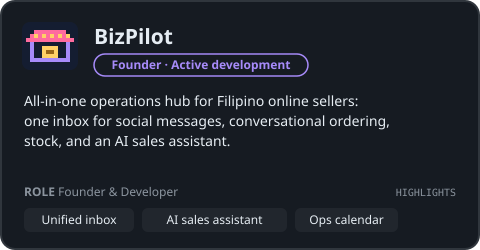</picture></a>
<br/><sub><a href="https://biz-pilot-msme.vercel.app/">Live site ↗</a> · 🔒 Private repository</sub>
</td>
<td width="50%" valign="top">
<picture><source media="(prefers-color-scheme: dark)" srcset="assets/profile/card-smartwatts-dark.svg"><source media="(prefers-color-scheme: light)" srcset="assets/profile/card-smartwatts-light.svg">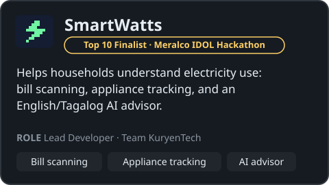</picture>
<br/><sub>Hackathon project · no public repository</sub>
</td>
</tr>
<tr>
<td width="50%" valign="top">
<a href="https://github.com/rolex-esto/opspilot"><picture><source media="(prefers-color-scheme: dark)" srcset="assets/profile/card-opspilot-dark.svg"><source media="(prefers-color-scheme: light)" srcset="assets/profile/card-opspilot-light.svg">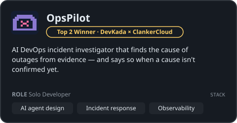</picture></a>
<br/><sub><a href="https://github.com/rolex-esto/opspilot">Repository ↗</a></sub>
</td>
<td width="50%" valign="top">
<a href="https://baha-route.vercel.app/"><picture><source media="(prefers-color-scheme: dark)" srcset="assets/profile/card-baharoute-dark.svg"><source media="(prefers-color-scheme: light)" srcset="assets/profile/card-baharoute-light.svg">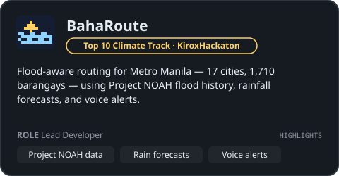</picture></a>
<br/><sub><a href="https://github.com/rolex-esto/KiroxQuick_Flood_CTRL">Repository ↗</a> · <a href="https://baha-route.vercel.app/">Live demo ↗</a></sub>
</td>
</tr>
<tr>
<td width="50%" valign="top">
<a href="https://kiroverse-hack-sprint-shipaton-edition.vercel.app/"><picture><source media="(prefers-color-scheme: dark)" srcset="assets/profile/card-wwl-dark.svg"><source media="(prefers-color-scheme: light)" srcset="assets/profile/card-wwl-light.svg">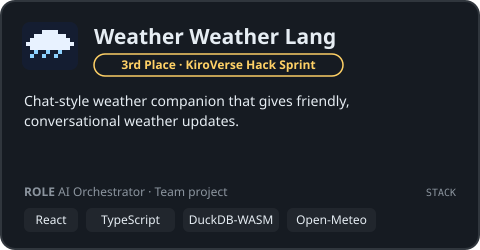</picture></a>
<br/><sub><a href="https://github.com/rolex-esto/Kirovers-Hack-Sprint-Shipaton-Edition">Repository ↗</a> · <a href="https://kiroverse-hack-sprint-shipaton-edition.vercel.app/">Live demo ↗</a></sub>
</td>
<td width="50%" valign="top">
<a href="https://github.com/rolex-esto/kiro-phWeather"><picture><source media="(prefers-color-scheme: dark)" srcset="assets/profile/card-ulanba-dark.svg"><source media="(prefers-color-scheme: light)" srcset="assets/profile/card-ulanba-light.svg">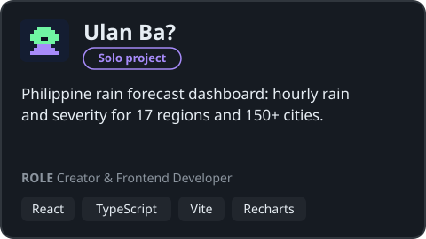</picture></a>
<br/><sub><a href="https://github.com/rolex-esto/kiro-phWeather">Repository ↗</a></sub>
</td>
</tr>
</table>

**More work:** [**Classic Flagship Store**](https://classicflagshipstore.com/) — e-commerce capstone with admin, cashier and customer dashboards, Google sign-in and inventory tools (PHP · MySQL · Google OAuth; private repo) · [**TAPME**](https://tapmeph.com/) — freelance NFC tap pages and client websites (2025 – Present).

<details>
<summary><b>Project details</b></summary>

<br/>

**BizPilot** — Gives Filipino online sellers one inbox for social messages, one-click ordering in conversations, stock management, and a shared operations calendar. It includes an AI sales assistant and keeps each seller’s data private.

**SmartWatts** — An informational and tracking tool that helps households understand electricity use through bills, appliance records, meter readings, trends, estimates, and practical suggestions. SmartWatts Personal includes goals, challenges, rewards, and an AI advisor in English and Tagalog. SmartWatts Rentals helps property managers organize units, invite tenants, record readings, and prepare electricity statements, giving managers and tenants a shared view of unit usage.

**OpsPilot** — Helps tech teams investigate system outages using evidence and makes clear when the cause has not yet been confirmed.

**BahaRoute** — Helps Metro Manila drivers choose routes away from flooded roads across 17 cities and 1,710 barangays, using Project NOAH flood history, live rainfall forecasts, and spoken hazard alerts.

**Weather Weather Lang** — A chat-style weather companion that gives people weather updates in a friendly, conversational way. Built with React 18, TypeScript, Vite, DuckDB-WASM, Parquet, Recharts, the Open-Meteo API and Playwright.

**Ulan Ba?** — Helps Filipinos plan travel and outdoor activities around expected rainfall, with hourly rain and severity forecasts for 17 regions and 150+ cities and automatic location detection.

**Classic Flagship Store** — An online store for Classic Flagship Store with separate admin, cashier, and customer dashboards, secure Google sign-in, and inventory tools.

</details>


## Tech Stack

<picture>
  <source media="(prefers-color-scheme: dark)" srcset="assets/profile/tech-stack-dark.svg">
  <source media="(prefers-color-scheme: light)" srcset="assets/profile/tech-stack-light.svg">
  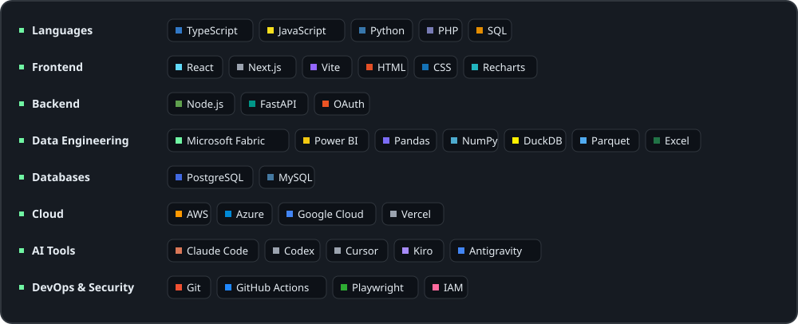
</picture>


## Achievements & Certifications

<picture>
  <source media="(prefers-color-scheme: dark)" srcset="assets/profile/hackathons-dark.svg">
  <source media="(prefers-color-scheme: light)" srcset="assets/profile/hackathons-light.svg">
  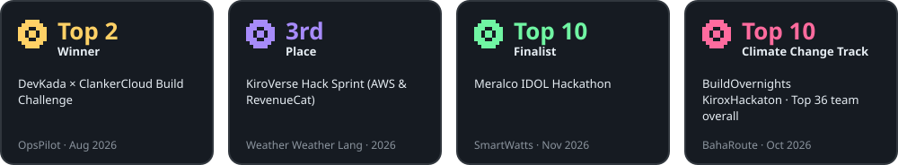
</picture>

| Result | Event | Project / Role |
|:--|:--|:--|
| **Top 2 Winner** | DevKada × ClankerCloud Build Challenge (August 24–29, 2026) | [OpsPilot](https://github.com/rolex-esto/opspilot) · Solo Developer |
| **3rd Place** | KiroVerse Hack Sprint (AWS &amp; RevenueCat, June – August 2026) | [Weather Weather Lang](https://github.com/rolex-esto/Kirovers-Hack-Sprint-Shipaton-Edition) · AI Orchestrator |
| **Top 10 Finalist** | Meralco IDOL Hackathon · Meralco Power Academy (November 12–13, 2026) | **Team KuryenTech** · Lead Developer |
| **Top 36 Team · Top 10 Climate Change Track** | BuildOvernights KiroxHackaton (AWS Office, October 3–4, 2026) | [BahaRoute](https://github.com/rolex-esto/KiroxQuick_Flood_CTRL) · Lead Developer |

**Featured certification —** **Microsoft Certified: Fabric Data Engineer Associate (DP-700)** · Earned Nov 2026 · Valid until Nov 10, 2027 · [**Verify on Microsoft Learn ↗**](https://learn.microsoft.com/en-us/users/rolexesto-7021/credentials/certification/fabric-data-engineer-associate?tab=credentials-tab)

| Area | Certifications |
|:--|:--|
| **Microsoft & Cloud** | Microsoft Certified: Fabric Data Engineer Associate (DP-700) · AWS SimuLearn: Cloud Practitioner *(training)* |
| **Data** | DataCamp Certified Associate Data Engineer · Associate Data Analyst · SQL Associate · Data Literacy |
| **Security** | ISC2 Certified in Cybersecurity (CC) · DICT-Recognized Cybersecurity Professional, Category 2 *(professional recognition)* · Appkademiya Certified Cybersecurity Professional (CCP) · Red Team Leaders CTIGA |
| **AI** | Google AI Professional Certificate |
| **Training** | DICT Region V Data Privacy Protection Competency Framework, 20-Hour Intensive Training |

<details>
<summary><b>Certificate gallery</b> · 10 certifications · 1 training certificate</summary>

<br/>

<table width="100%">
<tr><td align="center" valign="top" width="50%"><a href="assets/certs/dp700.png"></a><br/><b>Microsoft Certified: Fabric Data Engineer Associate (DP-700)</b><br/><sub>Microsoft · Nov 2026 · Valid until Nov 10, 2027</sub></td><td align="center" valign="top" width="50%"><a href="assets/certs/aws-simulearn.png">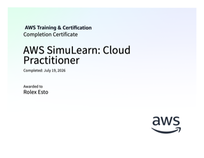</a><br/><b>AWS SimuLearn: Cloud Practitioner</b><br/><sub>AWS · Jul 2026 · Training, completion certificate</sub></td></tr>
<tr><td align="center" valign="top" width="50%"><a href="assets/certs/datacamp-data-engineer.png"></a><br/><b>DataCamp Certified Associate Data Engineer</b><br/><sub>DataCamp · Jul 2026</sub></td><td align="center" valign="top" width="50%"><a href="assets/certs/datacamp-data-analyst.png"></a><br/><b>DataCamp Certified Associate Data Analyst</b><br/><sub>DataCamp · May 2026</sub></td></tr>
<tr><td align="center" valign="top" width="50%"><a href="assets/certs/datacamp-sql.png"></a><br/><b>DataCamp Certified SQL Associate</b><br/><sub>DataCamp · Apr 2026</sub></td><td align="center" valign="top" width="50%"><a href="assets/certs/datacamp-data-literacy.png"></a><br/><b>DataCamp Certified in Data Literacy</b><br/><sub>DataCamp · Jul 2026</sub></td></tr>
<tr><td align="center" valign="top" width="50%"><a href="assets/certs/isc2-cc.png"></a><br/><b>Certified in Cybersecurity (CC)</b><br/><sub>ISC2 · Mar 2026 · Cycle: Mar 2026 – Feb 2029</sub></td><td align="center" valign="top" width="50%"><a href="./dict-cyberpro-badge.png"></a><br/><b>DICT-Recognized Cybersecurity Professional, Category 2</b><br/><sub>DICT · Sep 2026 · Professional recognition</sub></td></tr>
<tr><td align="center" valign="top" width="50%"><a href="assets/certs/appkademiya-ccp.png"></a><br/><b>Certified Cybersecurity Professional (CCP)</b><br/><sub>Appkademiya · Aug 2026</sub></td><td align="center" valign="top" width="50%"><a href="assets/certs/ctiga.png"></a><br/><b>Certified Threat Intelligence &amp; Governance Analyst (CTIGA)</b><br/><sub>Red Team Leaders · Jan 2026</sub></td></tr>
<tr><td align="center" valign="top" width="50%"><a href="assets/certs/google-ai.png"></a><br/><b>Google AI Professional Certificate</b><br/><sub>Google · Aug 2026</sub></td><td></td></tr>
</table>

</details>

<details>
<summary><b>Certification journey</b> · January 2026 → November 2026</summary>

<br/>

| Date | Milestone |
|---|---|
| **January 2026** | Red Team Leaders Certified Threat Intelligence &amp; Governance Analyst (CTIGA) |
| **March 2026** | ISC2 Certified in Cybersecurity (CC) |
| **April 2026** | DataCamp Certified SQL Associate |
| **May 2026** | DataCamp Certified Associate Data Analyst |
| **June 2026** | DICT Region V Data Privacy Protection Competency Framework, 20-Hour Intensive Training |
| **July 2026** | DataCamp Certified Associate Data Engineer · DataCamp Certified in Data Literacy · AWS SimuLearn Cloud Practitioner |
| **August 2026** | Google AI Professional Certificate · Appkademiya Certified Cybersecurity Professional (CCP) |
| **September 2026** | DICT-Recognized Cybersecurity Professional Category 2 (Intermediate) |
| **November 2026** | Microsoft Certified: Fabric Data Engineer Associate (DP-700) |

</details>

<sub>Only the DP-700 has a verification link; every other thumbnail opens the full-size certificate image. DICT Category 2 is a professional recognition, not an exam certificate. AWS SimuLearn and DICT Region V are training.</sub>


## Experience & Fellowships

| Role | Organization | Period |
|---|---|---|
| **Freelance Web Developer** | [TAPME](https://tapmeph.com/) | 2025 – Present |
| **Startup Founder & Developer** | BizPilot | Active development |
| **Data Innovation Fellow**, Cohort 11 | Eskwelabs Innovation Fellowship (EIF) | August 2026 – November 2026 |
| **Participant**, Data Science & AI | GCI World 2026 · Matsuo-Iwasawa Laboratory, University of Tokyo | September 2026 – November 2026 |
| **BSIT student** | STI College Fairview, Quezon City, PH | September 2023 – July 2027 |

<details>
<summary><b>What I do at TAPME</b></summary>

<br/>

- Build the pages that open when customers tap TAPME NFC products, including digital calling cards, Google Review and social media tap pages, menus, and brochures.
- Develop client websites for TAPME packages, from showcase sites to sites with admin tools owners can manage.
- Make sure every tap or QR scan opens cleanly on any phone.

</details>

<details>
<summary><b>Fellowships & professional training</b></summary>

<br/>

**Eskwelabs Innovation Fellowship (EIF)** — Selected for Cohort 11’s Data Innovation track, collaborating on projects across analytics, data modeling, strategy and management, and learning experience design (August 2026 – November 2026).

**GCI World 2026** — Completed a global data science and AI program under the Matsuo-Iwasawa Laboratory, University of Tokyo, applying data-driven methods and intelligent systems to real-world software and data engineering projects (September 2026 – November 2026).

**Completed professional tracks:** AWS SimuLearn Cloud Practitioner (July 2026) · DICT Region V Data Privacy Protection Competency Framework, 20-Hour Intensive Training (June 2026).

</details>

<details>
<summary><b>Leadership & affiliations</b></summary>

<br/>

- **Founding President**, Microsoft Student Community, STI Fairview
- **AWS Learning Club Lead**, AWS Student User Group Philippines
- **Delegate / Representative**, Data Engineering Pilipinas x Echelon 2026 by Brainsparks (August 25–26, 2026)
- **Venue Partnerships Associate**, Seekers Guild (August 2026 – November 2026)

**Affiliations:** ISC2 Philippines Chapter · Data Engineering Pilipinas × DataCamp Donates (Scholar) · STI Fairview Bytes · STI Alumni Scholarship · DTI Metro Manila × Google Career Certificate Scholar · Cisco NetConnect PUP – Manila (Cybersecurity Operations)

</details>


## GitHub Stats

<p align="center">
  <picture>
    <source media="(prefers-color-scheme: dark)" srcset="https://raw.githubusercontent.com/rolex-esto/rolex-esto/output/stats-activity-dark.svg">
    <source media="(prefers-color-scheme: light)" srcset="https://raw.githubusercontent.com/rolex-esto/rolex-esto/output/stats-activity-light.svg">
    
  </picture>
  <picture>
    <source media="(prefers-color-scheme: dark)" srcset="https://raw.githubusercontent.com/rolex-esto/rolex-esto/output/stats-languages-dark.svg">
    <source media="(prefers-color-scheme: light)" srcset="https://raw.githubusercontent.com/rolex-esto/rolex-esto/output/stats-languages-light.svg">
    
  </picture>
</p>

<p align="center">
  <picture>
    <source media="(prefers-color-scheme: dark)" srcset="https://raw.githubusercontent.com/rolex-esto/rolex-esto/output/github-snake-dark.svg">
    <source media="(prefers-color-scheme: light)" srcset="https://raw.githubusercontent.com/rolex-esto/rolex-esto/output/github-snake.svg">
    
  </picture>
</p>

<sub>Stats are generated daily from GitHub's API by this repo's own workflow — no third-party stats service.</sub>


## Take a Break — Play My Arcade Game

<table>
<tr>
<td width="55%" valign="middle">
<a href="https://rolex-esto.github.io/rolex-esto/arcade/"></a>
</td>
<td valign="middle">

**ROLEX.EXE: BUG HUNTER** is a small pixel game I built from scratch. Clear five worlds, each themed on one of my projects, by collecting tokens and dodging bugs. It also has a portfolio terminal (`help`, `projects`, `contact`…).

<a href="https://rolex-esto.github.io/rolex-esto/arcade/"></a>
<a href="arcade/"></a>

<sub><kbd>WASD</kbd> / arrow keys to move · <kbd>P</kbd> to pause · touch controls on mobile · vanilla JS, no dependencies</sub>

</td>
</tr>
</table>


<div align="center">

## Let's Connect

I'm most interested in opportunities where I can build, experiment, ship, and learn from real-world problems.

<a href="https://rolex-esto.vercel.app/"></a>
<a href="https://linkedin.com/in/rolex-esto-1b33b2391/"></a>
<a href="mailto:rolexesto0001@gmail.com"></a>

</div>
