<!-- INK COLUMN 2.0 · the portfolio's design tokens (rolex-esto/portfolio app/globals.css).
     Static art: assets/readme/ from scripts/generate-profile-art.py. Developer Overview: left panel built daily by
     .github/workflows/snake.yml (scripts/generate-github-stats.py, output branch); right panel assets/dashboard/
     from scripts/generate-dashboard-art.py. Every fact shown in an image is also written as text below it. -->

<picture><source media="(prefers-color-scheme: dark)" srcset="assets/readme/hero-dark.svg"><source media="(prefers-color-scheme: light)" srcset="assets/readme/hero-light.svg"></picture>

**Software Engineering · AI · Data Engineering · Cloud**

4th-year BSIT student, founder of BizPilot and Microsoft Certified Fabric Data Engineer. 
I build practical, production-ready products across web, AI, data and cloud.

## <picture><source media="(prefers-color-scheme: dark)" srcset="assets/readme/icons/analytics-dark.svg"><source media="(prefers-color-scheme: light)" srcset="assets/readme/icons/analytics-light.svg"></picture> Developer Overview

<!-- Both panels are 410 wide: side by side on desktop, stacked on phones. -->

  <picture>
    <source media="(prefers-color-scheme: dark)" srcset="https://raw.githubusercontent.com/rolex-esto/rolex-esto/output/overview-activity-dark.svg">
    <source media="(prefers-color-scheme: light)" srcset="https://raw.githubusercontent.com/rolex-esto/rolex-esto/output/overview-activity-light.svg">
    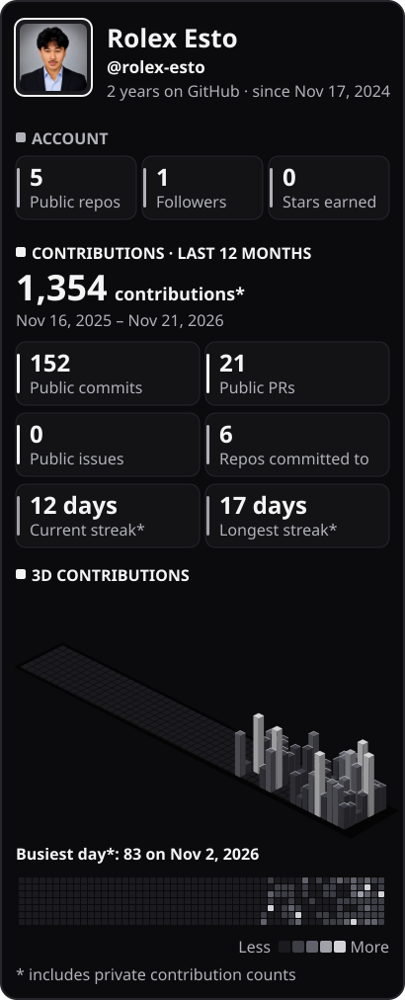
  </picture>
  <picture>
    <source media="(prefers-color-scheme: dark)" srcset="assets/dashboard/portfolio-dark.svg">
    <source media="(prefers-color-scheme: light)" srcset="assets/dashboard/portfolio-light.svg">
    
  </picture>

Activity panel rebuilt daily from the GitHub API. Account totals are current; commits, pull requests, issues and streaks cover the last 12 months (dates on the panel). Commits, pull requests and issues count public activity only. Values marked * also include private contribution counts that the profile shows; nothing else private is read.

## <picture><source media="(prefers-color-scheme: dark)" srcset="assets/readme/icons/trophy-dark.svg"><source media="(prefers-color-scheme: light)" srcset="assets/readme/icons/trophy-light.svg"></picture> Achievements

**4× hackathon top finishes in 2026**, each with the project built for it.

<picture><source media="(prefers-color-scheme: dark)" srcset="assets/readme/award-devkada-dark.svg"><source media="(prefers-color-scheme: light)" srcset="assets/readme/award-devkada-light.svg">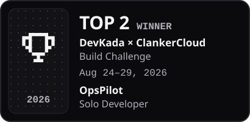</picture>
<picture><source media="(prefers-color-scheme: dark)" srcset="assets/readme/award-meralco-dark.svg"><source media="(prefers-color-scheme: light)" srcset="assets/readme/award-meralco-light.svg">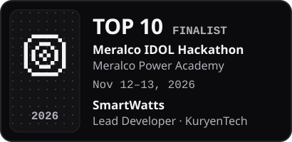</picture>

<picture><source media="(prefers-color-scheme: dark)" srcset="assets/readme/award-kiroverse-dark.svg"><source media="(prefers-color-scheme: light)" srcset="assets/readme/award-kiroverse-light.svg">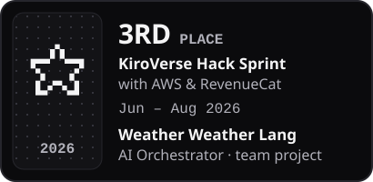</picture>
<picture><source media="(prefers-color-scheme: dark)" srcset="assets/readme/award-buildovernights-dark.svg"><source media="(prefers-color-scheme: light)" srcset="assets/readme/award-buildovernights-light.svg">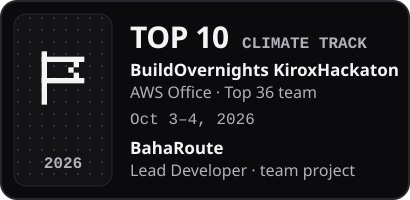</picture>

## <picture><source media="(prefers-color-scheme: dark)" srcset="assets/readme/icons/folder-dark.svg"><source media="(prefers-color-scheme: light)" srcset="assets/readme/icons/folder-light.svg"></picture> Featured Projects

Eight builds, from a startup product to hackathon winners and client work. Links to each live site or repository are next to its card.

<picture><source media="(prefers-color-scheme: dark)" srcset="assets/readme/project-bizpilot-dark.svg"><source media="(prefers-color-scheme: light)" srcset="assets/readme/project-bizpilot-light.svg">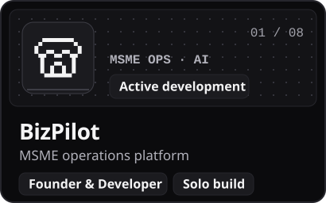</picture>

### BizPilot

**Founder & Developer · solo build · active development** · [**Live site →**](https://biz-pilot-msme.vercel.app/) · <picture><source media="(prefers-color-scheme: dark)" srcset="assets/readme/icons/lock-dark.svg"><source media="(prefers-color-scheme: light)" srcset="assets/readme/icons/lock-light.svg"></picture> Private repository

**Problem:** Filipino online sellers juggle messages, orders and stock across scattered social channels, leading to overselling and manual errors.

**Built:** One inbox for customer messages, one-click ordering inside conversations, stock and a shared operations calendar, with a grounded AI sales assistant and per-seller data isolation.

**Key features:** unified inbox · conversational ordering · AI sales assistant · calendar sync

 

<picture><source media="(prefers-color-scheme: dark)" srcset="assets/readme/project-opspilot-dark.svg"><source media="(prefers-color-scheme: light)" srcset="assets/readme/project-opspilot-light.svg">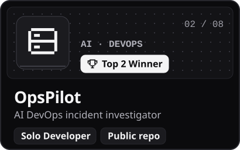</picture>

### OpsPilot

**Solo Developer** · [**Repository →**](https://github.com/rolex-esto/opspilot)

**Problem:** Under incident pressure, teams can act on a plausible but wrong root cause, and an AI assistant that sounds certain makes that worse.

**Built:** An AI DevOps incident investigator that works from evidence and states clearly when the cause has not been confirmed yet.

**Recognition:** Top 2 Winner · DevKada × ClankerCloud Build Challenge (August 24–29, 2026) **Focus:** AI agent design · prompt and skill architecture · cloud observability

 

<picture><source media="(prefers-color-scheme: dark)" srcset="assets/readme/project-smartwatts-dark.svg"><source media="(prefers-color-scheme: light)" srcset="assets/readme/project-smartwatts-light.svg">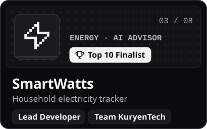</picture>

### SmartWatts

**Lead Developer, Team KuryenTech** · No public link yet

**Problem:** Households and property managers lack a clear picture of where their electricity use and bills come from.

**Built:** Bill scanning, appliance tracking, usage trends, estimates and suggestions. SmartWatts Personal adds goals, rewards and an AI advisor in English and Tagalog; SmartWatts Rentals prepares electricity statements for tenants.

**Recognition:** Top 10 Finalist · Meralco IDOL Hackathon, Meralco Power Academy (November 12–13, 2026)

 

<picture><source media="(prefers-color-scheme: dark)" srcset="assets/readme/project-baharoute-dark.svg"><source media="(prefers-color-scheme: light)" srcset="assets/readme/project-baharoute-light.svg">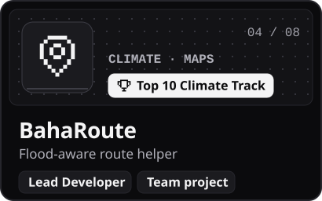</picture>

### BahaRoute

**Lead Developer · team project** · [**Repository →**](https://github.com/rolex-esto/KiroxQuick_Flood_CTRL) · [**Live demo →**](https://baha-route.vercel.app/)

**Problem:** Metro Manila drivers can't easily tell which roads are likely to flood before they set out.

**Built:** A route helper across 17 cities and 1,710 barangays that combines Project NOAH flood history, live rainfall forecasts and spoken hazard alerts. Built as a team in a 12-hour hackathon.

**Recognition:** Top 36 Team · Top 10 Climate Change Track, BuildOvernights KiroxHackaton at the AWS Office (October 3–4, 2026) **Stack:** React · TypeScript · Mapbox GL · Three.js · Python (data processing)

 

<picture><source media="(prefers-color-scheme: dark)" srcset="assets/readme/project-weather-weather-lang-dark.svg"><source media="(prefers-color-scheme: light)" srcset="assets/readme/project-weather-weather-lang-light.svg">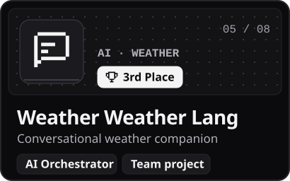</picture>

### Weather Weather Lang

**AI Orchestrator · team project** · [**Team repo →**](https://github.com/rolex-esto/Kirovers-Hack-Sprint-Shipaton-Edition) · [**Live demo →**](https://kiroverse-hack-sprint-shipaton-edition.vercel.app/)

**Problem:** A forecast readout alone doesn't tell people what to do, for example whether to travel today.

**Built:** A chat-style weather companion that extends Ulan Ba? with a conversational assistant, a decision layer and client-side SQL.

**Recognition:** 3rd Place · KiroVerse Hack Sprint: Shipaton Edition, with AWS &amp; RevenueCat (June – August 2026) **Stack:** React · TypeScript · Vite · DuckDB-WASM · Parquet · Recharts · Open-Meteo API · Playwright · Kiro

 

<picture><source media="(prefers-color-scheme: dark)" srcset="assets/readme/project-ulan-ba-dark.svg"><source media="(prefers-color-scheme: light)" srcset="assets/readme/project-ulan-ba-light.svg">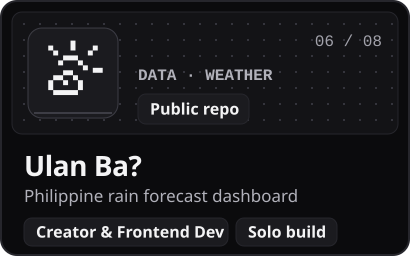</picture>

### Ulan Ba?

**Creator & Frontend Developer · solo build** · [**Repository →**](https://github.com/rolex-esto/kiro-phWeather)

**Problem:** People planning trips and outdoor activities need to know when and where rain is expected.

**Built:** Hourly rain and severity forecasts for 17 regions and 150+ cities, with automatic location detection. It later became the base of Weather Weather Lang.

**Stack:** React · TypeScript · Vite · Recharts · Open-Meteo API

 

<picture><source media="(prefers-color-scheme: dark)" srcset="assets/readme/project-classic-flagship-store-dark.svg"><source media="(prefers-color-scheme: light)" srcset="assets/readme/project-classic-flagship-store-light.svg">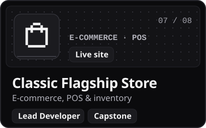</picture>

### Classic Flagship Store

**Lead Developer · capstone project** · [**Live site →**](https://classicflagshipstore.com/) · <picture><source media="(prefers-color-scheme: dark)" srcset="assets/readme/icons/lock-dark.svg"><source media="(prefers-color-scheme: light)" srcset="assets/readme/icons/lock-light.svg"></picture> Private repository

**Problem:** Running inventory and daily store operations by hand is slow and error-prone.

**Built:** An online store with separate admin, cashier and customer dashboards, secure Google sign-in and inventory tools, deployed live.

**Stack:** PHP · MySQL · PDO · Google OAuth · Gemini AI · PHPMailer · Hostinger

 

<picture><source media="(prefers-color-scheme: dark)" srcset="assets/readme/project-tapme-dark.svg"><source media="(prefers-color-scheme: light)" srcset="assets/readme/project-tapme-light.svg">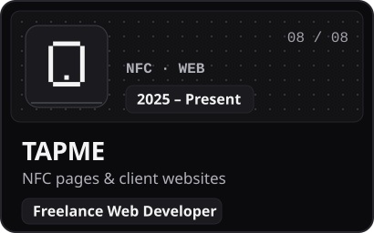</picture>

### TAPME

**Freelance Web Developer · 2025 – Present** · [**Website →**](https://tapmeph.com/)

**Problem:** Businesses need a fast way to share their details and collect reviews from a single tap or scan.

**Built:** The pages that open when customers tap TAPME NFC products (calling cards, Google Review and social tap pages, menus, brochures), plus client websites with admin tools.

 

## <picture><source media="(prefers-color-scheme: dark)" srcset="assets/readme/icons/briefcase-dark.svg"><source media="(prefers-color-scheme: light)" srcset="assets/readme/icons/briefcase-light.svg"></picture> Experience

#### Freelance Web Developer · [TAPME](https://tapmeph.com/)
`2025 – Present` · Freelance 
Builds NFC tap pages and client websites for TAPME packages, and makes sure every tap or QR scan opens cleanly on any phone.

#### Startup Founder & Developer · BizPilot
`Active development` · Own startup project 
Founded and builds BizPilot end to end: inbox, conversational ordering, AI sales assistant and operations calendar.

#### Data Innovation Fellow, Cohort 11 · Eskwelabs Innovation Fellowship (EIF)
`August 2026 – November 2026` · Fellowship 
Data Innovation track: projects across analytics, data modeling, strategy and management, and learning experience design.

#### Participant, Data Science & AI · GCI World 2026
`September 2026 – November 2026` · Global program, Matsuo-Iwasawa Laboratory, University of Tokyo 
Completed a global data science and AI program, applying data-driven methods and intelligent systems to software and data engineering projects.

#### BSIT Student · STI College Fairview
`September 2023 – July 2027` · Education, Quezon City, PH 
4th-year Bachelor of Science in Information Technology.

<b>What I do at TAPME</b>

 

- Build the pages that open when customers tap TAPME NFC products, including digital calling cards, Google Review and social media tap pages, menus, and brochures.
- Develop client websites for TAPME packages, from showcase sites to sites with admin tools owners can manage.
- Make sure every tap or QR scan opens cleanly on any phone.

## <picture><source media="(prefers-color-scheme: dark)" srcset="assets/readme/icons/users-dark.svg"><source media="(prefers-color-scheme: light)" srcset="assets/readme/icons/users-light.svg"></picture> Leadership & Community

- **Founding President** · Microsoft Student Community, STI Fairview
- **AWS Learning Club Lead** · AWS Student User Group Philippines
- **Delegate / Representative** · Data Engineering Pilipinas × Echelon 2026 by Brainsparks · `August 25–26, 2026`
- **Venue Partnerships Associate** · Seekers Guild · `August 2026 – November 2026`

**Affiliations:** ISC2 Philippines Chapter · Data Engineering Pilipinas × DataCamp Donates (Scholar) · STI Fairview Bytes · STI Alumni Scholarship · DTI Metro Manila × Google Career Certificate Scholar · Cisco NetConnect PUP – Manila (Cybersecurity Operations)

## <picture><source media="(prefers-color-scheme: dark)" srcset="assets/readme/icons/code-dark.svg"><source media="(prefers-color-scheme: light)" srcset="assets/readme/icons/code-light.svg"></picture> Tech Stack

<picture><source media="(prefers-color-scheme: dark)" srcset="assets/readme/stack-a-dark.svg"><source media="(prefers-color-scheme: light)" srcset="assets/readme/stack-a-light.svg">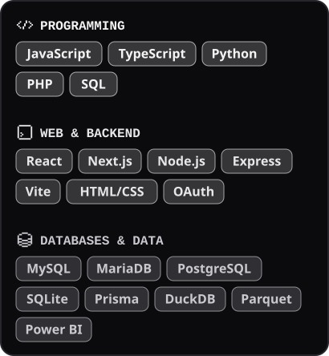</picture>
<picture><source media="(prefers-color-scheme: dark)" srcset="assets/readme/stack-b-dark.svg"><source media="(prefers-color-scheme: light)" srcset="assets/readme/stack-b-light.svg">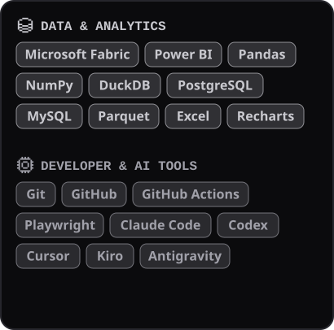</picture>

Tools I use to build. These are not certifications; credentials are listed separately below.

## <picture><source media="(prefers-color-scheme: dark)" srcset="assets/readme/icons/notes-dark.svg"><source media="(prefers-color-scheme: light)" srcset="assets/readme/icons/notes-light.svg"></picture> Certifications

**Featured credentials**

<picture><source media="(prefers-color-scheme: dark)" srcset="assets/readme/cred-dp700-dark.svg"><source media="(prefers-color-scheme: light)" srcset="assets/readme/cred-dp700-light.svg">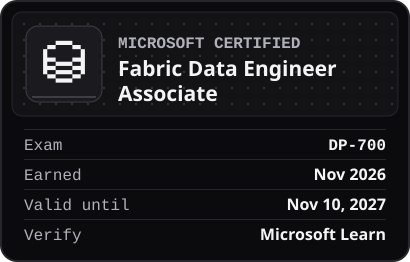</picture>
<picture><source media="(prefers-color-scheme: dark)" srcset="assets/readme/cred-isc2-cc-dark.svg"><source media="(prefers-color-scheme: light)" srcset="assets/readme/cred-isc2-cc-light.svg">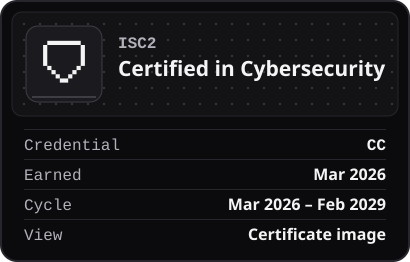</picture>

<picture><source media="(prefers-color-scheme: dark)" srcset="assets/readme/icons/external-link-dark.svg"><source media="(prefers-color-scheme: light)" srcset="assets/readme/icons/external-link-light.svg"></picture> [**Verify DP-700 on Microsoft Learn**](https://learn.microsoft.com/en-us/users/rolexesto-7021/credentials/certification/fabric-data-engineer-associate?tab=credentials-tab) · [ISC2 CC certificate](assets/certs/isc2-cc.png)

**9** certifications · **1** professional recognition (DICT, Category 2) · **5** training completions, counted separately

<b>All 9 certifications</b> · by date

 

- **Microsoft Certified: Fabric Data Engineer Associate (DP-700)** · Microsoft · `Nov 2026` · valid until Nov 10, 2027 · [verify](https://learn.microsoft.com/en-us/users/rolexesto-7021/credentials/certification/fabric-data-engineer-associate?tab=credentials-tab)
- **Google AI Professional Certificate** · Google · `Aug 2026` · [certificate](assets/certs/google-ai.png)
- **Certified Cybersecurity Professional (CCP)** · Appkademiya · `Aug 2026` · [certificate](assets/certs/appkademiya-ccp.png)
- **DataCamp Certified Associate Data Engineer** · DataCamp · `Jul 2026` · [certificate](assets/certs/datacamp-data-engineer.png)
- **DataCamp Certified in Data Literacy** · DataCamp · `Jul 2026` · [certificate](assets/certs/datacamp-data-literacy.png)
- **DataCamp Certified Associate Data Analyst** · DataCamp · `May 2026` · [certificate](assets/certs/datacamp-data-analyst.png)
- **DataCamp Certified SQL Associate** · DataCamp · `Apr 2026` · [certificate](assets/certs/datacamp-sql.png)
- **ISC2 Certified in Cybersecurity (CC)** · ISC2 · `Mar 2026` · cycle Mar 2026 – Feb 2029 · [certificate](assets/certs/isc2-cc.png)
- **Certified Threat Intelligence &amp; Governance Analyst (CTIGA)** · Red Team Leaders · `Jan 2026` · [certificate](assets/certs/ctiga.png)

<b>Recognition and training</b>

 

**Professional recognition** (not an exam certificate)
- **DICT-Recognized Cybersecurity Professional, Category 2 (Intermediate)** · DICT · `Sep 2026` · [badge](./dict-cyberpro-badge.png)

**Training completions**
- **AWS SimuLearn: Cloud Practitioner** · AWS · `Jul 2026` · [completion certificate](assets/certs/aws-simulearn.png)
- **Microsoft DP-900, DP-700 and PL-300 curriculum tracks** · Microsoft · `Jul – Oct 2026`
- **DICT Region V Data Privacy Protection Competency Framework**, 20-Hour Intensive Training · `Jun 2026`

<b>Certificate gallery</b> · thumbnails open the full image

 

<a href="./dict-cyberpro-badge.png">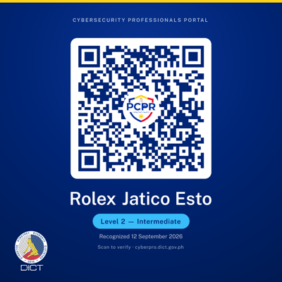</a>

Only DP-700 has a public verification link; other entries open the full-size certificate image.

## <picture><source media="(prefers-color-scheme: dark)" srcset="assets/readme/icons/chart-dark.svg"><source media="(prefers-color-scheme: light)" srcset="assets/readme/icons/chart-light.svg"></picture> Activity

  <picture>
    <source media="(prefers-color-scheme: dark)" srcset="https://raw.githubusercontent.com/rolex-esto/rolex-esto/output/stats-languages-dark.svg">
    <source media="(prefers-color-scheme: light)" srcset="https://raw.githubusercontent.com/rolex-esto/rolex-esto/output/stats-languages-light.svg">
    
  </picture>

  <picture>
    <source media="(prefers-color-scheme: dark)" srcset="https://raw.githubusercontent.com/rolex-esto/rolex-esto/output/github-snake-dark.svg">
    <source media="(prefers-color-scheme: light)" srcset="https://raw.githubusercontent.com/rolex-esto/rolex-esto/output/github-snake.svg">
    
  </picture>

Languages and the contribution snake are generated by this repository's own workflow. Streaks and totals are in the <a href="#developer-overview">Developer Overview</a>.

## <picture><source media="(prefers-color-scheme: dark)" srcset="assets/readme/icons/mail-dark.svg"><source media="(prefers-color-scheme: light)" srcset="assets/readme/icons/mail-light.svg"></picture> Let's Connect

I'm most interested in opportunities where I can build, experiment, ship, and learn from real-world problems.

