<div align="center">



# BUG HUNTER — Developer Quest

**A playable pixel-art arcade portfolio.** Five worlds, each built around a real project. Collect every token, dodge the bugs, and step through the portal to unlock the project file.

</div>

## Play it

- **Online:** **[rolex-esto.github.io/rolex-esto/arcade/](https://rolex-esto.github.io/rolex-esto/arcade/)** (GitHub Pages)
- **Locally:** the game uses JavaScript modules, which browsers block on `file://`. From the repository root, run:

  ```bash
  python3 -m http.server 8000
  # then open http://localhost:8000/arcade/
  ```

Not here to play? Every project is listed in the **quest log** on the game page and in the [profile README](../README.md#world-map), with no gameplay required.

## Worlds

| # | World | Project | Twist |
|:-:|:--|:--|:--|
| 1 | Merchant Kingdom | BizPilot | Patrolling broken transactions |
| 2 | Energy Realm | SmartWatts | Bouncing power surges |
| 3 | Incident Dungeon | OpsPilot | Darkness + chasing corrupted processes |
| 4 | Floodlands | BahaRoute | Flood water slows you down |
| 5 | Weather World | Weather Weather Lang | Wind lanes push you sideways |
| ☂ | Rain Observatory (bonus) | Ulan Ba? | 90-second time attack |

## Controls

| Action | Keyboard | Touch |
|:--|:--|:--|
| Move | <kbd>WASD</kbd> / arrow keys | On-screen D-pad (hold) |
| Pause / resume | <kbd>P</kbd>, <kbd>Esc</kbd> or <kbd>Space</kbd> | Ⅱ button |
| Restart level | <kbd>R</kbd> while paused | Pause menu |
| Mute | <kbd>M</kbd> | Sound toggle |

Also included: power-ups (patch, firewall shield, cache boost), checkpoints, two continues per run, a persistent local best score, cosmetic skins, a read-only portfolio terminal (`help`, `about`, `projects`, `skills`, `achievements`, `contact`, `play`, `clear`), and a few hidden secrets.

**Accessibility:** follows `prefers-reduced-motion` (with an in-game toggle), has an assist mode (slower enemies, more HP, lighter darkness), announces game events to screen readers, works with the keyboard alone, and never autoplays sound.

## Code

```
arcade/
├── index.html          page shell, overlays, quest log, terminal
├── css/arcade.css      design tokens + responsive layout
├── fonts/              Press Start 2P (SIL OFL 1.1, see OFL.txt)
└── js/
    ├── main.js         wiring: UI, input, settings, saves
    ├── game.js         engine: movement, collisions, enemies, rendering
    ├── levels.js       tile maps + themes
    ├── sprites.js      original pixel art as character maps
    ├── audio.js        Web Audio synthesized 8-bit SFX
    ├── terminal.js     fixed-command portfolio shell (no eval/innerHTML)
    ├── storage.js      guarded localStorage (game progress only)
    └── data.js         portfolio facts shown in the game
```

There are no dependencies, build steps, backend, or external requests at runtime. XP, levels and badges are game mechanics. They are not professional credentials.
